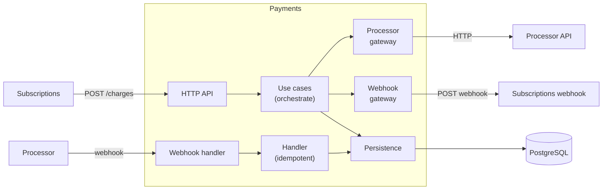

> The code on these pages has not been run yet. Treat it as a sketch until the companion repository exists.

Payments is the second service. Unlike Subscriptions (domain-heavy), Payments is gateway-heavy: it orchestrates calls to a card processor and callbacks to Subscriptions. The [journey through one service](/journeys/build-one-service-testably/) already showed the Subscriptions side of the exchange: its [outbound gateway](/patterns/inside-a-service/outbound-http-gateway/) calls `POST /charges`, and its [webhook handler](/patterns/inside-a-service/inbound-http-gateway/) receives the outcome. This journey is the other half.

## What's different from the first service

| Concept | Subscriptions | Payments | New page |
|---|---|---|---|
| Entry points | HTTP API, Payments webhook, `AccountClosed` message | Synchronous HTTP API, async webhook from the processor | [Synchronous inbound](/patterns/between-services/synchronous-inbound-pending/) |
| Domain | Complex state machine with rules | Simple charge settlement | (same as Subscriptions) |
| Use cases | Domain decides, persistence saves | Gateway orchestration | (same as Subscriptions) |
| Contracts | Consumer of Payments (`/charges`), Inventory and Accounts; reader of the Payments webhook | Consumer of the processor; provider of `/charges` and of the webhook Subscriptions reads | [Contracts](/patterns/between-services/bidirectional-contracts/) |
| Outbound calls | HTTP (Payments, Inventory), messages | HTTP to processor, HTTP webhook to Subscriptions | [Webhook as a boundary](/patterns/between-services/webhook-idempotency/) |
| Failures | Transient (retry broker) | Transient (retry later), permanent (give up) | [Error classification](/patterns/between-services/error-classification/) |
| Idempotency | Listener and webhook handler deduplicate by recorded event or message id | The processor's webhook handler deduplicates the same way; Payments' own retries are made safe with an idempotency key | [Webhook idempotency](/patterns/between-services/webhook-idempotency/) |

## Architecture



## Synchronous inbound

Subscriptions makes a synchronous HTTP call: `POST /charges`. Payments responds immediately with a charge ID and status `pending`. Later, when the processor completes the charge, Payments calls a Subscriptions webhook asynchronously.

**Why this matters:**
- Subscriptions gets immediate feedback (charge created)
- Payment processing is async (processor takes time)
- Failures are classified: sync (bad request, auth) vs async (processor timeout)

See [Synchronous inbound](/patterns/between-services/synchronous-inbound-pending/).

## Contracts

Payments is both a *consumer* and a *provider* of contracts:

- **Consumer of the processor:** Payments states what it needs from the processor API. The processor is a third party, so Payments cannot ask it to verify anything; see [contracts](/patterns/between-services/bidirectional-contracts/).
- **Provider to Subscriptions:** Subscriptions states what it reads from the webhook, and Payments verifies that it sends it. The same goes for `/charges`.

Both are testable and shareable ([stopping contract drift](/journeys/stop-contract-drift/) covers the exchange).

See [Bidirectional contracts](/patterns/between-services/bidirectional-contracts/).

## Webhooks

A webhook is different from a message listener or an HTTP route. The caller (processor) does not wait for a response and may retry unpredictably. The handler must be idempotent.

See [Webhook idempotency](/patterns/between-services/webhook-idempotency/).

## Error classification

When the use case calls gateways, failures are not all equal:

- **Transient:** processor timeout, network error → retry later
- **Permanent:** bad request, auth failure, 4xx → give up and report to Subscriptions

The gateway decides which is which and returns a result that the use case can act on.

See [Error classification](/patterns/between-services/error-classification/).

## Code structure

The working implementation is in `payments/`:

```
payments/
├── src/
│   ├── charge/                    # domain
│   │   ├── charge.ts              # Charge type, settle() function
│   │   ├── charge-db.ts           # persistence
│   │   ├── initiate-charge.ts     # use case
│   │   ├── settle-charge.ts       # use case
│   │   └── web/
│   │       └── charge-routes.ts   # HTTP routes
│   ├── gateway/
│   │   ├── processor-gateway.ts   # outbound: call processor (consumer contract)
│   │   └── webhook-gateway.ts     # outbound: call Subscriptions webhook (provider contract)
│   └── webhook/
│       └── processor-outcome-handler.ts  # inbound: processor webhook (idempotent)
└── test/
    ├── non-dom/
    │   ├── charge.test.ts
    │   ├── charge-db.test.ts
    │   ├── initiate-charge.test.ts
    │   ├── processor-gateway.test.ts
    │   ├── webhook-gateway.test.ts
    │   └── processor-outcome-handler.test.ts
    └── closed-box/
        └── charge.test.ts
```

Follow the test structure and tools from the Subscriptions journey (Testcontainers, Pact, neverthrow). The patterns are the same; only the concepts differ.

## What's still the same

These follow the Subscriptions journey directly and are not repeated here:

- **Domain tests:** Pure functions, sociable, no mocks (see [domain](/patterns/inside-a-service/domain/))
- **Use case tests:** Real DB, mock gateways, test orchestration (see [use case](/patterns/inside-a-service/use-case/))
- **Persistence tests:** Real DB container, round-trip tests, query correctness (see [persistence](/patterns/inside-a-service/persistence/))
- **Inbound HTTP tests:** Real server, mock use case, error mapping (see [inbound HTTP](/patterns/inside-a-service/inbound-http-gateway/))
- **Closed-box tests:** Real service in process, mocked neighbors, few tests (see [closed-box](/patterns/inside-a-service/closed-box-test/))

## Next

[Stop contract drift](/journeys/stop-contract-drift/) covers contract management across teams: how the consumer contract from Payments is verified by the processor, how the provider contract to Subscriptions is verified by Subscriptions, and what happens when either side changes the contract.
