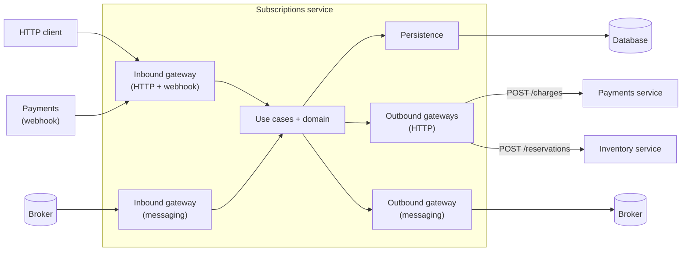

> The code on these pages has not been run yet. Treat it as a sketch until the companion repository exists.

A product subscription app is split across teams. Each owns one service:

| Service | Owns |
|---|---|
| **Subscriptions** (this part) | plans, subscription lifecycle, billing cycle, renewals, cancellation |
| Inventory | product stock and reservations |
| Payments | charging, refunds, payment methods |
| Accounts | users, profiles, account closure |

Subscriptions carries the most behaviour, so it carries Part 1.

## The service and its edges

| Edge | Direction | Detail |
|---|---|---|
| HTTP API | in | `POST /subscriptions`, `POST /subscriptions/:id/cancel`, `GET /subscriptions/:id` |
| Webhook | in | `POST /webhooks/payment-outcome` (Payments reports whether a charge succeeded or failed) |
| Messages consumed | in | `AccountClosed` (Accounts) |
| Messages published | out | `SubscriptionRenewed`, `SubscriptionCancelled` |
| HTTP client | out | Payments: `POST /charges` (answers `pending`; the outcome arrives later by webhook). Inventory: `POST /reservations` |
| Database | out | subscriptions, billing schedule, processed webhook and message ids |

## The boundaries and their tests

One page per boundary. "Gateway" is the umbrella for code that crosses the service edge, qualified by direction and protocol.

| Boundary | Test name | Real | Replaced | Page |
|---|---|---|---|---|
| Domain logic | **Domain test** (sociable) | Domain objects | Nothing; the domain has no dependencies | [domain](/patterns/inside-a-service/domain/) |
| Use case | **Use case test** | Use case, domain, PostgreSQL container | Only a failing `save`, by a spy | [use-case](/patterns/inside-a-service/use-case/) |
| Persistence | **Persistence test** | PostgreSQL container | Nothing | [persistence](/patterns/inside-a-service/persistence/) |
| HTTP, inbound (API and Payments webhook) | **Inbound gateway test (HTTP)** | Real server, routes; database for the webhook's duplicate check | Use case | [http](/patterns/inside-a-service/inbound-http-gateway/) |
| HTTP, outbound (Payments, Inventory) | **Outbound gateway test (HTTP)** | Gateway, HTTP client | Remote service, by a contract mock server | [gateway](/patterns/inside-a-service/outbound-http-gateway/) |
| Messaging, inbound (`AccountClosed`) | **Inbound gateway test (messaging)** | Handler; PostgreSQL and Redpanda containers | Use case, in the handler tests | [messaging-inbound](/patterns/inside-a-service/inbound-messaging/) |
| Messaging, outbound (`SubscriptionRenewed`) | **Outbound gateway test (messaging)** | Publisher; Redpanda container | Nothing | [messaging-outbound](/patterns/inside-a-service/outbound-messaging/) |
| Whole service | **Closed-box component test** | Everything the service owns, in containers | Remote services, by static stubs | [closed-box](/patterns/inside-a-service/closed-box-test/) |

The contract halves of the gateway tests, and who owns the files they produce, are Part 3.

## Decisions that shape these pages

1. **Sociable domain tests, with a domain that has no dependencies.** Domain tests call pure functions and use the real domain objects they collaborate with. Nothing is replaced because nothing outside the domain is involved. Loading and storing belong to the use case, which has its own small suite.
2. **Real infrastructure in containers, not in-memory lookalikes.** Anything that needs a database or a broker uses Testcontainers with the production engine and the production migrations. In-memory substitutes differ from the real thing where it matters (types, constraints, ordering, delivery semantics), and the time they save is small. The cost is managed by starting each container once per run and resetting state between tests. Things owned by *other* teams are never containers: they are contract mocks or static stubs.
3. **Container reuse keeps feedback fast.** One PostgreSQL and one Redpanda container start per test run, not per test. Databases reset state by truncating tables; the broker resets by creating topics per run and using unique message ids. Developers see near-instant repeat runs locally (thanks to Docker reuse), and the suite is easier to distribute than one that needs a container-per-test-file.
4. **Charging is a synchronous request with an asynchronous answer.** Subscriptions asks Payments to charge with `POST /charges` and receives `pending` at once. It treats the charge as unsettled until Payments calls back on the webhook. The request carries an idempotency key, so a retry after a timeout cannot charge twice, and the webhook carries an event id, so a repeated delivery cannot be applied twice. The payment rules (grace period, restart) stay in the domain; HTTP is only how the facts arrive.
5. **Closed-box tests are kept, with limits.** Rainsberger's critique is that tests depending on several pieces of non-trivial behaviour multiply code paths. What keeps closed-box tests on the safe side of it: one behaviour per test, one deployable owned by one team, every neighbour replaced by a controlled stub, and far fewer closed-box tests than domain tests (as a rule of thumb, one per happy-path journey plus one per major error scenario involving multiple components). Rule combinations are tested in the domain tests. This is this series' position, reasoned from Clemson and Rainsberger; neither states it.
6. **Every boundary has a test; exceptions are recorded.** The exceptions are in the table below.

### Exceptions for Subscriptions

| Exception | Reason |
|---|---|
| Inbound HTTP gateway test is optional on a thin API, but not for the webhook | Routing is covered by the closed-box test. The webhook has duplicates, bad signatures and malformed bodies, so it earns its own test |
| Inbound handler tests (messaging and webhook) replace the use case; listener tests use the real broker | Duplicates and bad payloads are easier to provoke at the handler; listener tests verify delivery, acknowledgement and broker integration |
| Scheduled/batch jobs (e.g., nightly renewal) | Scheduled jobs call use cases just like message listeners do; closed-box tests cover them via the same use-case boundary |
| Timeouts are tested against a plain stub server, not the contract mock | A contract mock cannot delay its response |

### Test isolation and state management

**Database tests:** Shared PostgreSQL container (one per run) with tables truncated between tests. Truncation is fast (milliseconds), so every test starts from a clean state without paying container startup cost again.

**Broker tests:** Shared Redpanda container (one per run) with topics created per test run. Message ids are unique per run, so tests do not interfere; no cleanup needed between tests.

**HTTP tests:** Real HTTP server runs in process, single instance per test run. Tests that mock dependencies (like use-case mocks in the inbound HTTP test) serialize naturally; those that use the real service (closed-box tests) do not have side effects that persist across tests because the database is truncated and the broker topics are isolated per run.

**Container setup:** Containers are started and managed through a Bun `preload`, so they begin once for the entire test run. Locally, Docker's `--reuse` flag makes repeat runs near-instant. A suite that needs Docker cannot run without it; the pipeline and every developer machine must provide it.

## Coverage model: blind spots and handoffs

| Layer | Proves | Cannot catch |
|---|---|---|
| Domain test | Rules are correct | Loading, storing, wiring, serialisation |
| Use case test | Load → domain → store are connected | Rule details (domain tests) or how calls arrive (gateway tests) |
| Persistence test | Queries work against real engine | Business rules; only validates round-trips |
| Inbound gateway tests (HTTP, messaging) | Calls map to correct use cases and responses map correctly | Whether the domain does the right thing (domain tests) |
| Outbound gateway tests | Calls to neighbours are shaped as promised (Pact) | Whether neighbours really behave like the mock (Part 3) |
| Closed-box test | All layers work together for one behaviour | Anything about neighbours; static stubs replace them |
| **All of the above** | **One service in isolation** | **Whether Inventory, Payments and Accounts really match what we assumed; orchestration across services** |

The last row is the hand-off to Part 2 (a second service), Part 3 (contracts and mock drift), and Part 5 (end-to-end journeys).

## Series outline

1. **Inside one service: Subscriptions.** This part.
2. **A second service: Payments.** Gateway-heavy, little domain logic. It answers `POST /charges` and calls the Subscriptions webhook. Where do the tests concentrate?
3. **Across the boundary.** Contracts between Subscriptions, Payments and Inventory, and mock drift.
4. **Across teams.** Who owns the contracts, the pipelines and the deploy gates; how breaking changes are handled.
5. **Whole journey.** What is left for end-to-end tests.
6. **Organisation and business goals.** Team boundaries, cognitive load, feedback time, release frequency, incident cost.
