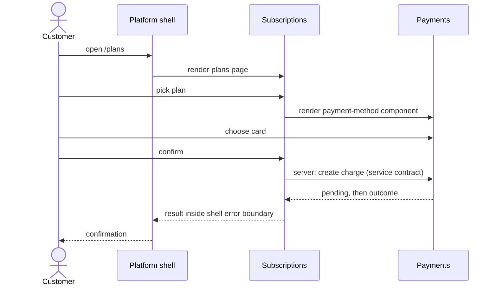

## The Problem

The earlier journeys gave us two services with safe contracts between them. The customer does not buy a service. They visit one coffee subscription website, pick a plan, add a card, and expect it to feel like one product.

That website is built from three teams' work:

- **Subscriptions**: plans, enrolment, billing dates, history
- **Payments**: cards, limits, charges, payment history
- **Channel Platform**: the app shell, navigation, design system, auth, pipeline

We cannot run two websites, and we cannot make one team write everything. So the question for this journey is not how to build a UI. It is how three teams work in one product, ship independently, and still look like one company.

## The Setting

Subscriptions and Payments keep their core services from the earlier journeys: separate repositories, APIs and events, independent deploys, contracts verified through a broker. What is new is the **customer-facing channel**, which is the only modular monolith and the only monorepo: one codebase, one deployment, a package per team. Each feature package has a `server/` and a `client/` part. The Channel Platform owns the frame around them.

Each feature team therefore owns two things: its core service, and how customers use it (its feature in the channel). The monorepo exists because the user experience is where several teams' work meets in one request, and that complexity is cheaper to manage in one place. See [the monorepo layout](/patterns/across-teams/monorepo/).

The structure is the vehicle, not the message. The tooling (workspaces, build orchestration) is deliberately left out of the narrative. What matters is the way of working it makes possible, and what happens to that way of working when it is done badly.

## Six Topics

### [How the platform enables autonomy](/patterns/across-teams/platform-enables-autonomy/)
What the Channel Platform provides, what it deliberately does not, and how it keeps the product cohesive without becoming a bottleneck. Draws on cognitive load and minimal critical specification.

### [Team interaction patterns](/patterns/across-teams/team-interaction-patterns/)
Who works with whom, and in which mode: collaboration, X-as-a-Service, facilitation. Where each pairing in the coffee product sits today and when it should change.

### [Integration boundaries](/patterns/across-teams/integration-boundaries/)
Where a team's responsibility ends. Package exports, server APIs, UI extension points, and who owns a journey that crosses teams ("subscribe and pay").

### [Test boundaries in the channel](/patterns/across-teams/test-boundaries/)
The test that belongs to each boundary in the channel, what is real and replaced, who owns it, and when it runs under trunk-based development.

### [Failure and degradation](/patterns/across-teams/failure-and-degradation/)
What the customer sees when a core service is slow, down, or still processing, and who decides. Connects [error classification](/patterns/between-services/error-classification/) to the channel.

### [Ways of working in the channel monorepo](/patterns/across-teams/ways-of-working/)
Change, review, release, and incidents when several teams share one codebase and one deploy for the customer-facing channel. How to keep shared deployment from becoming shared coupling.

## Running Example

A customer subscribes to a coffee plan:

```
Browse plans          -> Subscriptions
Pick a plan           -> Subscriptions
Add / choose a card   -> Payments
Confirm and enrol     -> Subscriptions (calls Payments server)
See the result        -> Subscriptions page, platform frame, platform design system
```

Three teams' code runs in one request. Everything in this journey is about making that work without three teams needing to be in the same meeting.



## How This Connects

- **Contracts between separately deployed services** are already safe to rely on. They still apply unchanged, and now also cover the channel's server-side adapters calling each core service.
- **The channel** adds the boundaries a customer actually crosses: UI extension points, package exports, journey ownership.

## The Claim

A shared codebase does not force shared decisions. Autonomy comes from clear ownership and a small, stable set of agreements, not from separate repositories or separate deploys. Cohesion comes from the same small set of agreements, owned by a team whose job is to make everyone else faster.
