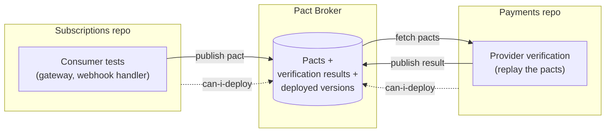

> The code on these pages has not been run yet. Treat it as a sketch until the companion repository exists.

## The problem

Subscriptions and Payments talk to each other in two directions:

- **Subscriptions calls** `POST /charges` on Payments and gets `pending`
- **Payments calls** the Subscriptions webhook, `POST /webhooks/payment-outcome`, with the outcome

Each team tested its side against a stand-in for the other: a contract mock in Subscriptions, a hand-written payload in Payments. Both suites pass. Nothing links the two stand-ins, and that is the gap:

```
Payments:      "We'll rename failureReason to failureCode."
               Its tests pass: nobody tests for failureReason.
Subscriptions: "We read failureReason to decide the grace period."
               Its tests pass: its stand-in still sends failureReason.
Production:    the grace period silently stops depending on why the payment failed.
```

This is the mock drift problem. A test double is only as good as its resemblance to the real thing, and the resemblance is checked by nobody. The same holds for every static stub and hand-built payload in Parts 1 and 2.

## The approach

**Consumer-driven contracts**, exchanged through a Pact Broker.

- The side that *reads* something writes down exactly what it reads, as part of its own tests. The recording is a **pact**.
- The side that *sends* it replays the pact against its real code. If it passes, the stand-in used by the reader is shown to match reality, at the level of message content and format.
- A broker stores the pacts, the verification results and which version of each service is live in each environment. Before deploying, a service asks the broker whether that version works with what is running where.

Both sides stay in their own repository and pipeline. They exchange a file, not a meeting.



## Who is the consumer

In a pact, the **consumer** is the side that reads. That is not always the side that calls.

| Interaction | Direction of the call | Consumer (writes the pact) | Provider (verifies it) |
|---|---|---|---|
| `POST /charges` | Subscriptions → Payments | Subscriptions | Payments |
| Payment outcome webhook | Payments → Subscriptions | Subscriptions (it reads the body) | Payments |
| Processor API | Payments → processor | Payments | The processor, in principle (see below) |

The webhook is modelled as a message contract: the body is what is agreed, and the HTTP delivery, the signature and the status codes are covered by Subscriptions' [webhook tests](/patterns/inside-a-service/inbound-http-gateway/#the-payments-webhook). Payments never writes a pact that says what Payments sends. It verifies what Subscriptions says it needs.

**The processor is different.** It is a third party: it will not replay Payments' pact, set up provider states, or join the broker. Inventory and Accounts follow the same pattern as Payments, because a team in the company sits on the other side. For the processor, the contract mock from Part 2 stays an assumption, re-checked by scheduled learning tests against the processor's sandbox. The broker, and the "can I deploy" gate, only cover what both sides take part in.

## Three topics

### [Consumer-driven contracts with Pact](/patterns/between-services/consumer-driven-contracts/)

How a pact is written, published and verified. What a verification does and does not prove.

### [Contract drift and breaking changes](/patterns/between-services/contract-drift/)

Two real changes, one asked for by the reader and one by the sender, and how the broker sequences them. The circular dependency that trips up new pacts.

### [Environments and "can I deploy?"](/patterns/between-services/deployment-gates/)

Versioned contracts per environment, recording deployments, the gate in each pipeline, and rollback.

## What this does and does not prove

| Layer | Proves | Cannot catch |
|---|---|---|
| Consumer test (gateway, webhook handler) | The reader can parse what it says it expects | Whether the sender sends it |
| Provider verification | The sender's real code produces what each reader says it expects | Behaviour the pact does not state: side effects, timing, ordering, retries |
| `can-i-deploy` | This version has been verified against the versions running in the target environment | Consumers that do not use the broker; the third-party processor |
| **All of the above** | **Message-level compatibility of the services that take part** | **Whether a charge really happens once, whether the webhook arrives after the commit, whether Payments retries as Subscriptions assumes** |

The last row is deliberate. A pact is an example of one message, not a specification of behaviour. Behaviour is tested inside each service (Parts 1 and 2), and the few behaviours that only exist across both are Part 5.

## Decisions that shape these pages

1. **The reader writes the contract.** The reader knows what it uses; the sender does not. A pact therefore lists only fields the reader depends on, and the sender is free to change everything else. The cost is that the sender must run its readers' expectations in its pipeline.
2. **A contract is an understanding, not a law.** A failed verification starts a conversation about who should change. Either side can propose a change to the contract. The tools make the conversation happen before production rather than after.
3. **The broker's job is to answer one question:** is this version compatible with what is running where? Everything else on its dashboard is a view of that.
4. **Assert shape, not wording.** Matchers state the type and form of a field, not its value. A pact that pins an exact message text blocks harmless changes.
5. **Semantics stay manual.** Nothing here checks that two tests, one on each side, agree about behaviour. A person has to keep them in step, which is a good reason to keep the surface small.

## Next: Part 4

Part 4 moves from services to teams: who owns the contracts, the pipelines and the gates, and what happens at the point where several teams' work reaches one customer.
