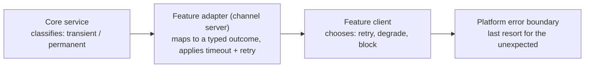
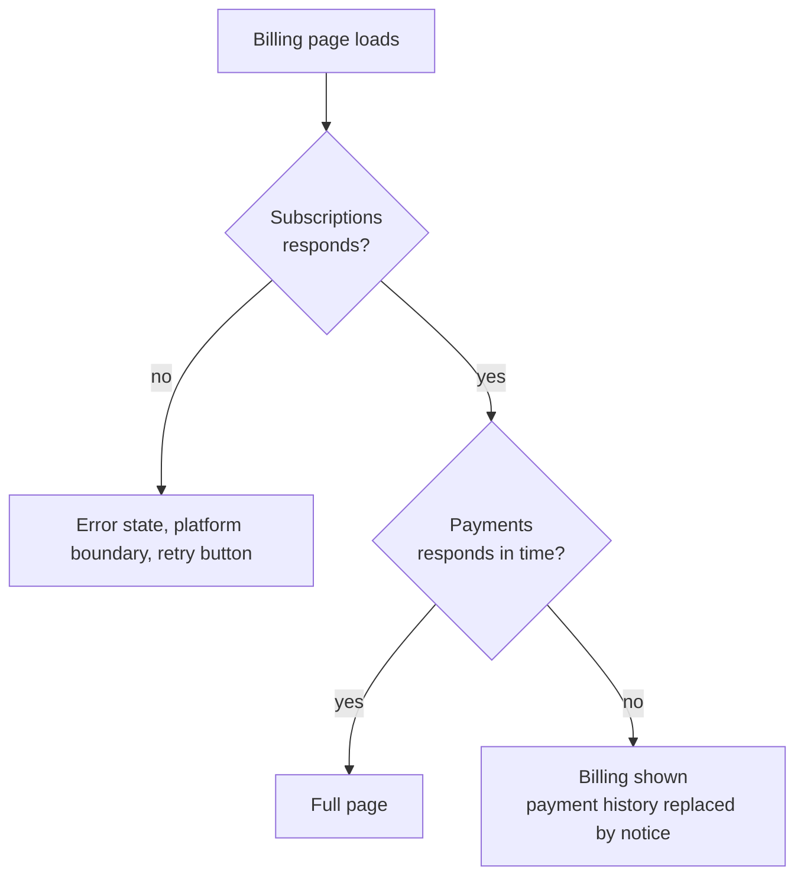
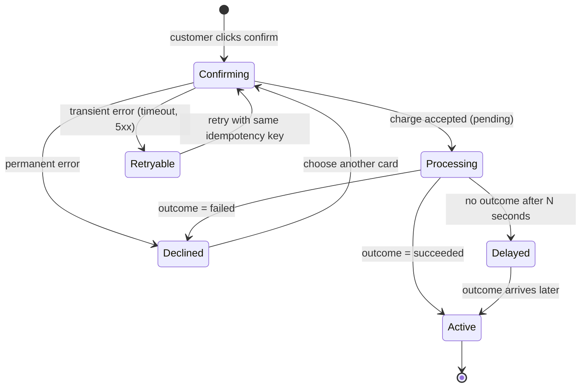

## Why This Is a Channel Problem

Core services fail independently: Subscriptions can be up while Payments is down. The customer does not see services, only one page that either works or does not. Someone has to decide, per page and per step, what "partly working" looks like. That decision is about the customer experience, so it belongs to the feature team, not to the platform and not to the core service.

Part 2's [error classification](/patterns/between-services/error-classification/) is what makes this tractable. The core service says *what kind* of failure it was (transient or permanent, retryable or not). The channel decides *what the customer sees*.

## Who Decides What

| Question | Decided by |
|---|---|
| Was the failure retryable? | The core service (in its gateway and API error shape) |
| Retry now, show a message, or degrade the page? | The feature team, in its channel adapter and client |
| What does any crashed page look like? | Platform error boundary |
| What does a degraded widget look like (style, wording)? | Design system, so it is consistent |

## Degradation Map for the Coffee Product

Each page lists what it needs and what it does without it. Writing this table is the exercise; the answers are a product decision.

| Page / step | Needs Subscriptions | Needs Payments | If Subscriptions is down | If Payments is down |
|---|---|---|---|---|
| Browse plans | Yes | No | Cached plans if fresh, else a clear "plans unavailable" | Unaffected |
| Billing overview | Yes | Optional (payment history) | Block, explain | Show billing, hide payment history with a notice |
| Saved cards | No | Yes | Unaffected | Show "cards unavailable", disable add and change |
| Checkout: confirm | Yes | Yes | Block (cannot enrol) | Block, offer to save the plan choice and return |

Rule: a widget that depends on a non-essential service must fail on its own, not take the page with it. Each feature exposes its widgets so a page can render them independently with their own loading and error states (the extension point supports this).

## The Pending Charge

Part 2: `POST /charges` returns `pending`, and the outcome arrives later by webhook. The customer's "confirm" click therefore usually ends in an *in-between* state, not success or failure.

Points the journey owner (Subscriptions) must settle:
- **Idempotency key per attempt** so a retry after a timeout cannot double-charge ([webhook idempotency](/patterns/between-services/webhook-idempotency/) is the same idea on the receiving side).
- **Processing is a real page state**, with copy and a way back to the account. The customer should be able to leave and come back.
- **Delayed is not Failed.** After the wait threshold, tell the customer we are still confirming and will email. Do not invite a second purchase.
- **Partial success**: charge succeeded, enrolment update failed. Recovery is owned by Subscriptions and driven by the webhook/event, not by the browser staying open.

## Timeouts, Retries, Breakers

Keep these in the adapter, where the knowledge of the neighbour lives:

- **Timeout budget**: page-level budget (say 2 s) split across calls, so one slow service cannot spend it all.
- **Retry only transient**, only idempotent calls, with backoff. Never retry a permanent failure.
- **Circuit breaker per core service**: after repeated transient failures, stop calling for a short time and serve the degraded state immediately instead of making every customer wait.
- **Fail fast to the degraded state** rather than spinning.

## Testing It

| What | Level | Replaced |
|---|---|---|
| Adapter maps each core-service failure to a typed outcome | Adapter test (outbound gateway, Part 1 style) | Core service, by contract mock |
| Timeouts and slow responses | Adapter test | Plain stub server (a contract mock cannot delay, Part 1) |
| Page renders each degraded state | Component test | Adapters, by fakes returning typed outcomes |
| Breaker opens and closes | Adapter test | Stub failing then recovering |
| Pending to Active and Declined paths | The one journey check | Core services, by static stubs; webhook simulated |

Failure scenarios are one of the few good reasons for extra journey-level checks: one per major error scenario involving several components, not one per combination.

## Contracts for Failure

Failure shapes are part of the contract. The core service's Pact should include its error responses (transient `503`, permanent `402`/`4xx`, with a stable error code), and the adapter's consumer Pact should assert only the codes it branches on (minimal critical specification). If the channel starts relying on an unstated error behaviour, an incident will find it; add it to the contract afterwards (see [ways of working](/patterns/across-teams/ways-of-working/)).

## Warning Signs

- A slow core service makes unrelated pages slow.
- Customers retry a purchase because the page gave no "processing" state.
- Every failure shows the platform's generic error page: feature teams have not designed degraded states.
- The platform team is writing retry logic for a feature: its remit is growing.
