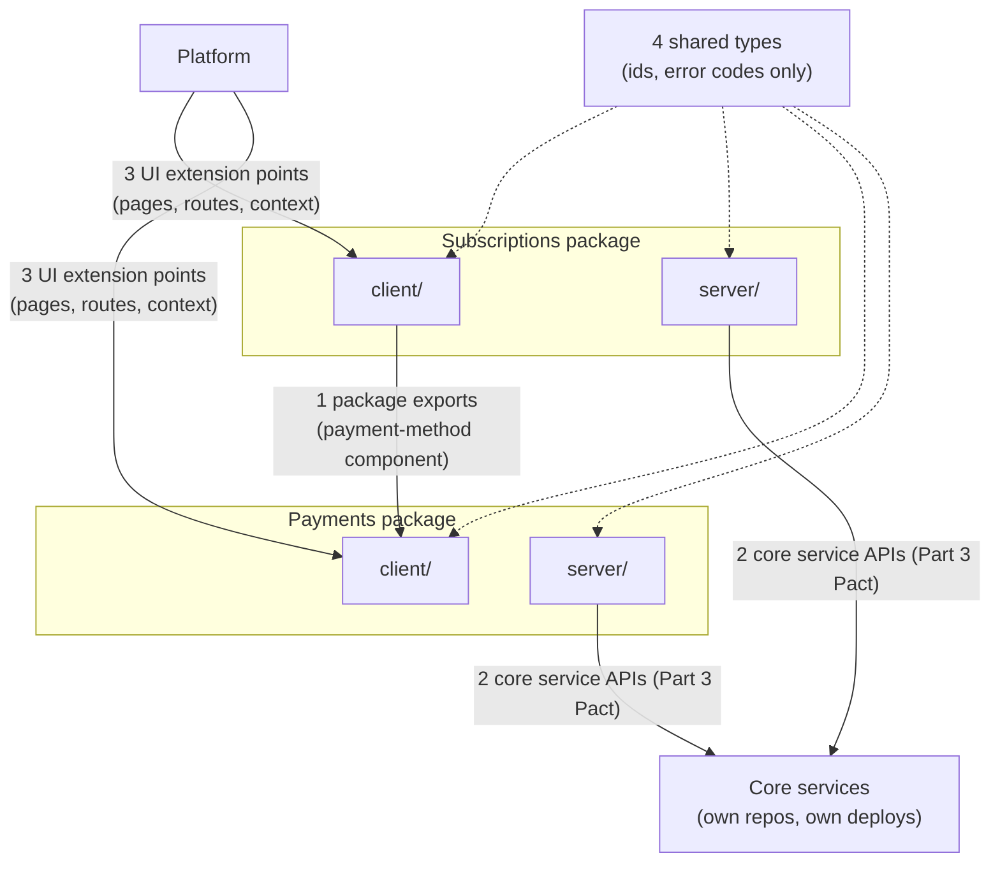
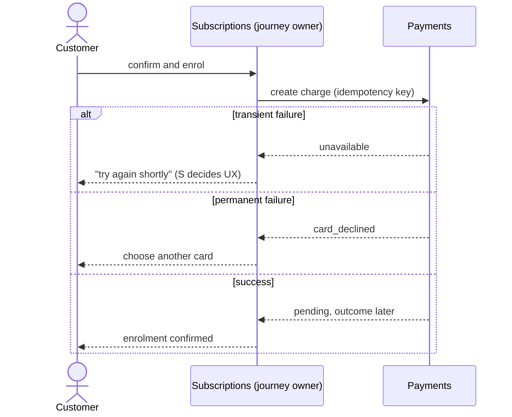

## A Boundary Is a Decision About Ownership

A boundary says: this side is yours, that side is theirs, and here is what we agree to share. Rainsberger puts it well: a contract is a record of a decision about where to put the boundaries between components, and it can be renegotiated (contract-testing). Inside the channel monorepo there are no network walls enforcing this, so the boundaries must be made explicit and checked, or they erode.

## The Boundaries in the Coffee Product

There are four kinds of boundary, each with an owner and a check.

### 1. Package exports

Each feature package exposes a small public surface (its pages, the components it offers others, the server functions it offers others) and keeps everything else internal.

- **Owner**: the package's team.
- **Check**: tooling that fails the build when one package imports another's internals. The point is not the tool; it is that "reaching past the boundary" is a build failure, not a code-review judgement call.
- **Rule of thumb**: if another team needs something that isn't exported, they ask the owning team to export it deliberately, or they don't use it.

### 2. Server APIs to the core services

Each feature's `server/` calls its own core service, and Subscriptions' checkout calls the Payments API. These are real network calls to separately deployed services, owned by the same teams that own the feature. The adapter in the channel is the consumer side of the contract.

- **Owner**: Payments owns the provider side; Subscriptions states what it needs as the consumer.
- **Check**: the Part 3 contracts and Pact verification continue to apply. Co-owning a feature and its service is not a reason to drop them: the two release on different cadences, and a feature in the channel may be calling a service version older than the one in the next release.

### 3. UI extension points

The platform defines how a package contributes to the shell. Payments exposing a payment-method component to Subscriptions' checkout is a similar, smaller extension point between two feature teams.

- **Owner**: the contributor owns the component; the consumer owns where and how it is used.
- **Check**: component-level contract checks (inputs, outputs, states it can be in), not full-page end-to-end tests.

### 4. Shared types and constants

A shared package holds things like identifiers and error codes. It is the easiest place to create accidental coupling.

- **Rule**: keep it tiny and boring. Domain concepts do not live here. If a type describes a subscription, it belongs to Subscriptions.

## Who Owns a Journey That Crosses Teams?

"Subscribe and pay" touches Subscriptions, Payments, and the platform frame. Without an answer to who owns it, everyone assumes someone else does, and defects fall between the teams.

**Position**: the team closest to the customer outcome owns the journey. Here that is Subscriptions: the customer's goal is to subscribe, and payment is a step within it.

What that ownership means:
- Subscriptions owns the checkout page and the sequence of steps.
- Subscriptions consumes Payments' payment-method component and server API as a service.
- Subscriptions is accountable for the journey working end to end, and runs the one shared end-to-end check for it.
- Payments is accountable for its component and API meeting their contract, including behaviour under failure.
- The platform is accountable for the frame, the design system, and the error boundary around it.

What it does not mean:
- It does not make Subscriptions the owner of card handling. Sensitive payment logic stays inside Payments.
- It does not put the journey in the platform. The platform sits in the middle of everything, which is exactly why it must not orchestrate.

If the journey later belongs more naturally to a dedicated checkout team, that is a team-topology change, not a code change, and the boundaries above make it a cheap one.

## Failure Across a Boundary

The boundary must define what each side does when the other fails, otherwise the customer sees whatever happens to leak through.

| Situation | Who decides the behaviour |
|---|---|
| Payments server is slow or down during checkout | Subscriptions decides what the customer sees; Payments defines the failure modes it can return |
| Charge fails after enrolment started | The journey owner (Subscriptions) defines recovery; Payments guarantees the charge outcome is reliable and idempotent (Part 2) |
| A feature page throws | The platform error boundary contains it; the owning team fixes it |
| The Payments component is unavailable | Subscriptions decides whether to degrade or block |

Writing these down is part of the contract. The Part 2 work on error classification (transient versus permanent) is what lets the consumer make these decisions sensibly.

## Keeping Contracts Small

Boundaries stay healthy when agreements are minimal (minimal critical specification). A consumer should assert only what it actually uses. A contract that pins every field and every validation rule blocks harmless changes by the other team and pushes teams back into constant coordination. A contract that is too loose gives false confidence. The right size is: everything the consumer relies on, nothing more.

## What Success Looks Like

- A team can change anything inside its package without telling anyone.
- A team changing something at a boundary finds out from CI, not from another team's incident.
- A journey has one named owner.
- The number of boundaries stays small enough that each one has a name and an owner.
