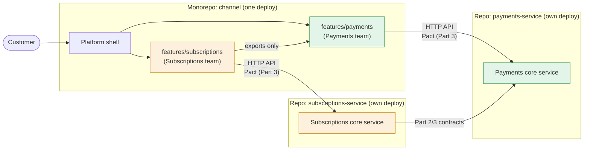
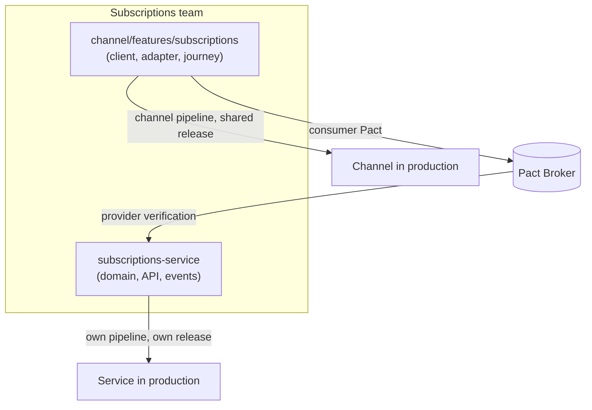
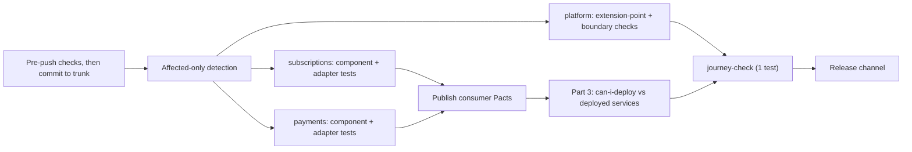

The earlier pages say "a package per team" but never show the repository. This page does, because Conway's Law is easiest to check against a directory tree: each top-level folder has one owner, and every arrow between folders is a boundary from [integration boundaries](/patterns/across-teams/integration-boundaries/).

> Sketch only. Tool names are illustrative; the narrative stays tool-agnostic (see the index).

## The Shape of the Decision

- **Core services stay where Parts 1-3 left them.** Subscriptions and Payments each have their own repository, database, pipeline and deploy. They expose APIs and events. Part 3 (Pact Broker, "can I deploy?") applies to them unchanged.
- **The customer-facing channel is the only monorepo and the only modular monolith.** One repository, one deploy, one package per team.
- **Each team owns both halves.** Subscriptions owns its core service *and* how customers use subscriptions (its feature in the channel). Payments likewise. The Platform team owns the frame.

Why a monorepo for the channel only: the experience is where the complexity of several teams' work meets in one customer request (shared shell, design system, auth, a checkout that spans features). Putting it in one codebase makes the shared frame, atomic cross-feature refactors, and one pipeline cheap. The domain services have no such need and gain independence from staying separate.



The colours show team ownership: each team spans a core service and a feature slice, joined by the same Part 3 mechanism as before.

## Layout

### Monorepo: `coffee-channel/`

```
coffee-channel/
├── app/                            # owner: Platform. Shell, routing, auth, error boundaries
├── server/                         # owner: Platform. Hosts feature servers; no journey logic
├── features/
│   ├── subscriptions/              # owner: Subscriptions
│   │   ├── client/                 # plans, checkout journey, billing pages
│   │   ├── server/                 # channel-side calls to subscriptions-service
│   │   │   └── adapter/            # the gateway: consumer side of the Part 3 Pact
│   │   └── index.ts                # public surface (exports)
│   └── payments/                   # owner: Payments
│       ├── client/                 # payment-method component, card management
│       ├── server/
│       │   └── adapter/            # consumer side of the Payments API Pact
│       └── index.ts
├── packages/                       # shared, deliberately small
│   ├── design-system/              # owner: Platform
│   ├── extension-api/              # owner: Platform. Page/route/context types
│   ├── telemetry/                  # owner: Platform. Correlation id, log shape
│   └── shared-types/               # owner: Platform (custodian). Ids and error codes ONLY
├── tooling/
│   ├── boundary-checks/            # fail build on imports past index.ts
│   ├── journey-check/              # the one "subscribe and pay" test, owner: Subscriptions
│   └── pipeline/                   # owner: Platform
├── OWNERS                          # folder -> team; read by checks to notify, not to gate
└── docs/                           # ADRs, boundary change log
```

### Outside the monorepo

```
subscriptions-service/   # Parts 1-3: src/, test/, db/, pacts/  (owner: Subscriptions)
payments-service/        # Parts 1-3: src/, test/, db/, pacts/  (owner: Payments; today: payments/)
pact-broker/             # shared registry from Part 3
```

The channel's `features/*/server/adapter/` is a **consumer** of the core service. It publishes a Pact to the broker like any other consumer, so the core service's team learns about channel needs from CI, not a meeting.

## What a Feature Team Owns



Two release cadences for one team: the service ships on its own; the feature ships with the channel. Because the team owns both sides of the adapter Pact, an API change and its channel update can be sequenced by one team (add to service, deploy, update adapter, remove old), which is the Part 3 pattern applied inside a team.

## Dependency Rules (what the boundary check enforces)

| From | May import | May not import |
|---|---|---|
| `features/X` | `packages/*`, other features' `index.ts` | other features' internals, `app/` internals |
| `features/X/server/adapter` | the core service's **published API client or schema** | the core service's source (separate repo, so structurally impossible) |
| `app/` | `packages/*`, features' registered pages via `extension-api` | feature internals, domain rules |
| `packages/shared-types` | nothing | anything domain-shaped |

Because core services are in other repos, the "reach past the boundary" check only has to guard the feature-to-feature and feature-to-platform edges inside the monorepo.

## Ownership and Notification

The channel is trunk-based with no pull requests, so ownership does not route approvals. It tells the checks whom to notify and which consumer checks to run.

```
/app  /server  /packages/**       @platform-team
/features/subscriptions/**        @subscriptions-team
/features/payments/**             @payments-team
/features/*/index.ts              @owner, notify @consumers   # boundary change
/features/*/server/adapter/       @owner                   # Pact published from here
```

A commit confined to one folder involves one team. Changing an `index.ts` runs the consumers' checks and notifies them automatically ([ways of working](/patterns/across-teams/ways-of-working/)).

## Pipeline Shape



The channel pipeline asks the broker whether the channel's adapters are compatible with the services *currently in production*. That is the one place where the two worlds connect.

## How It Grows

- A new team (say Loyalty) gets its own `loyalty-service` repo plus `features/loyalty/`. If the platform's extension points hold, no platform change is needed.
- If checkout needs its own team, move it from `features/subscriptions/client/checkout` to `features/checkout/`. It only used exports, so this is a rename plus an `OWNERS` line.
- If the channel deploy becomes a bottleneck, features can later become independently deployed micro-frontends. The `index.ts` surface becomes a network contract, and Part 3 tooling already covers that.

## Checks That Prove the Layout Is Honest

1. Every top-level monorepo folder has exactly one owner in `OWNERS`.
2. Deleting a feature folder breaks only its registration line in `app/`.
3. The monorepo has no source dependency on any core service, only on published API contracts.
4. The only test spanning `features/*` is `tooling/journey-check/`.
5. A core service can release with the channel pipeline paused, and vice versa.
