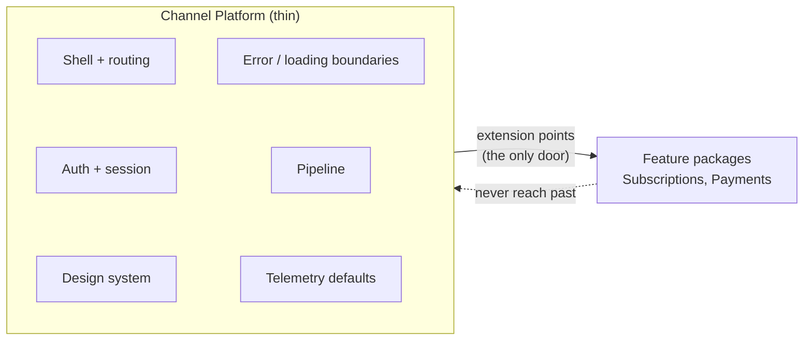
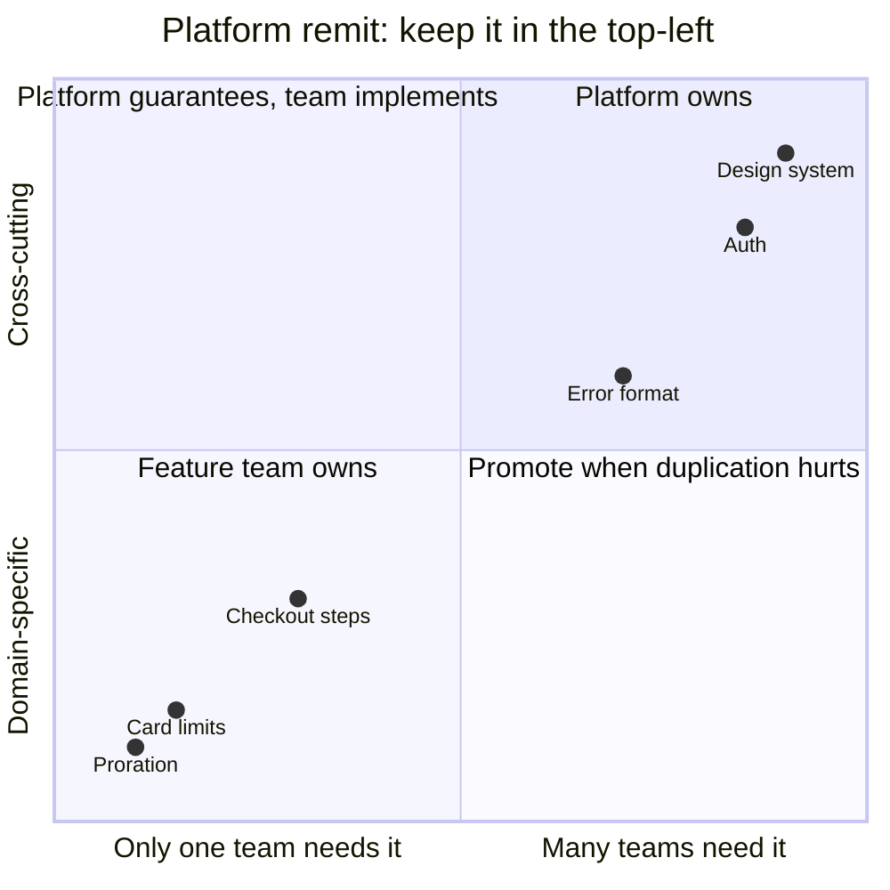

## The Tension

The company wants two things that pull against each other:

- **Autonomy**: Subscriptions and Payments each ship on their own schedule, make their own domain decisions, and do not wait on a central team.
- **Cohesion**: the customer sees one product with one look, one login, one navigation, and consistent behaviour when things go wrong.

Too little structure and you get two websites stitched together. Too much central control and every change queues behind one team. The Channel Platform exists to resolve this tension, and it does so by being deliberate about what it owns.

## What the Platform Provides

These are the things every feature team would otherwise rebuild, differently:

| Capability | Why a feature team should not own it |
|---|---|
| App shell, navigation, routing | Customers need one place to find things |
| Auth and session | One login, one identity, one security posture |
| Design system | Visual and interaction consistency |
| Error and loading boundaries | Failures look the same everywhere |
| Build, test and deploy pipeline | Release mechanics are not a domain concern |
| Observability defaults | Traces and logs correlate across teams |

In Team Topologies terms this is a platform team whose job is to take extraneous load off stream-aligned teams (see the note on team cognitive load in [team interaction patterns](/patterns/across-teams/team-interaction-patterns/)). A Subscriptions engineer should spend their capacity on subscription rules, not on how a modal behaves or how a session is refreshed.

## What the Platform Deliberately Does Not Own

- **Domain rules**: proration, retry policy, card limits. These belong to Subscriptions and Payments.
- **Journeys**: "subscribe and pay" is not a platform concern. It belongs to a feature team (see [integration boundaries](/patterns/across-teams/integration-boundaries/)).
- **How a feature team structures its own `server/` and `client/`**.

This is minimal critical specification applied to a product: be precise about what must be consistent, and leave the how to the people doing the work.

## The Few Decisions That Create Cohesion

Cohesion does not need many rules. It needs these held firmly:

1. **Look and interaction**: design tokens and components.
2. **Identity and navigation**: one login, one way to register a page.
3. **Extension points**: the single, documented way a team contributes a page, route, or widget.
4. **Cross-cutting guarantees**: accessibility floor, error behaviour, telemetry shape.

Everything else is the feature team's call. Each additional platform rule is a cost every team pays, so a rule needs a reason that survives challenge.

## The Extension Points Are the Contract

The platform and the feature teams meet at the extension points. For the coffee product that means:

- A feature package exports its pages and their route metadata.
- The shell provides context to those pages: authenticated customer, theme, locale, error boundary.
- The platform promises not to break these without notice. The feature team promises not to reach past them.

This is the same idea as the contracts between services, one layer up. The agreement is small, explicit, and checkable. Where service contracts verify server payloads, here the checks are things like "does every package's exported route registration still satisfy the shell's expectations". The check belongs in CI so a breaking change surfaces before merge, not in someone else's release.

## Interaction Mode: X-as-a-Service

Day to day, the platform is consumed, not collaborated with:

- Feature teams use the design system and extension points through documentation, not meetings.
- The platform team treats feature teams as customers: it measures whether they ship faster, not whether the platform is elegant.
- Collaboration mode is time-boxed. If a new capability needs a shell change (say, a new kind of checkout step), the platform and the requesting team pair for a short period, ship the extension point, and return to consumption.

See [team interaction patterns](/patterns/across-teams/team-interaction-patterns/).

## How This Enables Value Delivery on Their Own

Payments wants to add a new saved-card limit setting. What do they need from anyone else?

- A page in their package, using the design system: no ticket to the platform.
- A route registered through the existing extension point: no ticket.
- Server changes covered by their own tests and service contracts: only Subscriptions is told, via the contract pipeline, if it matters to them.
- Release through the shared pipeline: no custom process.

Nothing in that list needs a meeting. That is what autonomy means in practice: the common case needs no coordination.

## The Failure Mode: A Platform That Becomes a Queue

The dominant risk is the platform team growing thick:

- It starts orchestrating journeys because it sits in the middle.
- It gains opinions about domain behaviour.
- Feature teams wait on it for ordinary changes.

Symptoms to watch for:
- Feature teams routinely file requests to the platform for work inside their own package.
- The platform has product backlog items about checkout or billing logic.
- Feature commits wait on platform sign-off for changes that do not touch the frame.

The response is the Thinnest Viable Platform idea: provide the frame and the guarantees, push everything else back to the feature teams, and make the extension points richer instead of the platform's remit larger. If a capability is needed by only one team, it belongs in that team's package. If two teams need the same thing, the platform considers promoting it, but only when the duplication hurts.

## Conway's Law Check

The team structure is Platform, Subscriptions, Payments. The code structure is a platform package and two feature packages. The customer journey crosses all three. Because the packages match the teams, ownership of each part is clear. The seams between them are where agreement is needed, and the next pages address exactly those.

## Open Questions to Keep Honest

- Who decides when something moves from a feature package into the platform? A short, written criterion helps (two or more teams, stable shape, clear owner).
- How is the platform's own quality measured? Feature team lead time and satisfaction are better signals than platform feature count.
- What happens when the platform team is under-staffed? The product degrades toward the queue failure mode. That is a staffing and priority decision, not a technical one.
