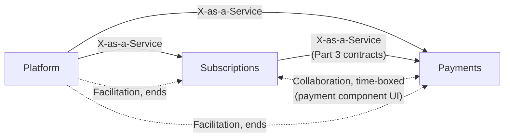
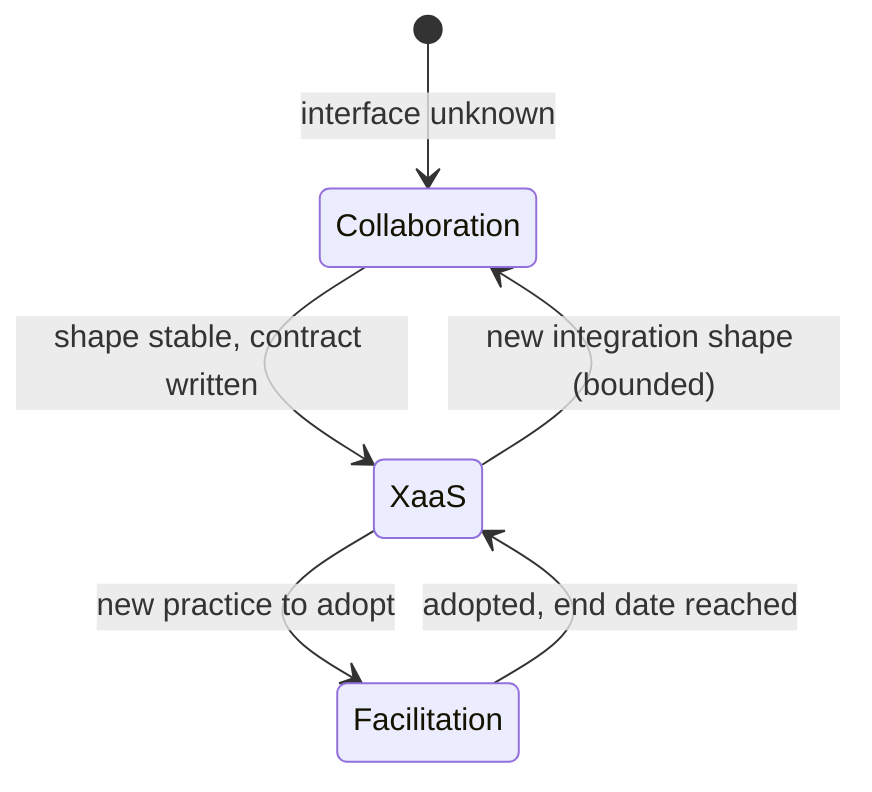

## Three Modes

Team Topologies describes three ways two teams can relate (Team Topologies):

- **Collaboration**: working closely together for a time-boxed period to discover something. High bandwidth, high cost.
- **X-as-a-Service**: one team provides, the other consumes, with little need to talk. Low cost when the interface is stable.
- **Facilitation**: one team helps another adopt a practice or capability, then steps back.

The useful discipline is to choose the mode deliberately for each pairing, and to change it when the situation changes. Most friction in multi-team products comes from being in the wrong mode: collaborating when a service interface would do, or consuming when the interface isn't stable enough yet.

## The Coffee Product Today

| Pairing | Mode | Why | What would change it |
|---|---|---|---|
| Platform to Subscriptions | X-as-a-Service | Stable shell, design system, extension points | A new platform capability being designed: temporary collaboration |
| Platform to Payments | X-as-a-Service | Same | Same |
| Subscriptions to Payments (server) | X-as-a-Service via contract | Part 3 contracts and the Pact Broker | A new integration shape (for example, a new charge flow): temporary collaboration |
| Subscriptions to Payments (journey UI) | Collaboration, then X-as-a-Service | The journey is new, so the shape of the payment-method component is still being found | Once stable, Payments offers it as a service and Subscriptions just consumes |
| Platform to both (adopting a practice) | Facilitation | For example, introducing accessibility checks or telemetry conventions | The practice is adopted, platform steps back |

The Subscriptions and Payments UI pairing is the interesting one. At first they should collaborate: a short, intense period where both teams sit with the problem, agree the component's inputs and outputs, and write the first contract. Once that shape holds, continuing to collaborate is waste. The mode should shift to X-as-a-Service, with the contract as the interface.

## Why Mode Matters for Tests

The test strategy follows the mode (team and test boundaries):

- **X-as-a-Service** pairs rely on contract tests. The consumer states what it needs, the provider verifies it, and nobody needs a meeting. This is Part 3.
- **Collaboration** pairs can afford shared, higher-level tests because they are working together anyway. But a shared end-to-end suite that persists after collaboration ends forces collaboration on everyone, forever.

A shared end-to-end suite is therefore a cost, not a safety net by default. Keep a small number, owned explicitly, for journeys that genuinely span teams.

## Signals You Are in the Wrong Mode

**Collaborating when you should be consuming:**
- Routine changes need a call with the other team.
- A release is blocked until a person from another team confirms something the contract could have confirmed.

**Consuming when you should be collaborating:**
- The interface keeps changing under you.
- Every release produces a surprise.
- Each team is making private assumptions about the other's behaviour.

The fix in both cases is the same question: is the interface stable enough to be a service? If yes, write it down and verify it with a contract. If not, spend a bounded time working together to make it stable, then switch.

## Facilitation in Practice

The platform team is the natural facilitator for cross-cutting practices. Examples for this product:

- Teaching feature teams how to write the platform's extension-point checks.
- Introducing a shared standard for error messages.
- Helping a team adopt telemetry conventions.

Facilitation has an end date. If the platform team is still hand-holding the same team a quarter later, the practice isn't landing, and the right response is to find out why, not to keep facilitating.

## Cognitive Load Is the Constraint

Each team can hold only so much (team cognitive load). Interaction modes spend that budget:

- Collaboration with another team costs load on both sides.
- Every extra team you must understand to do your job adds load.
- X-as-a-Service is cheap because you only need to know the interface.

If Subscriptions must understand Payments' internals to ship a plan change, the interface is leaking and load is being spent in the wrong place. The remedy is a better boundary, which is the subject of [integration boundaries](/patterns/across-teams/integration-boundaries/).
