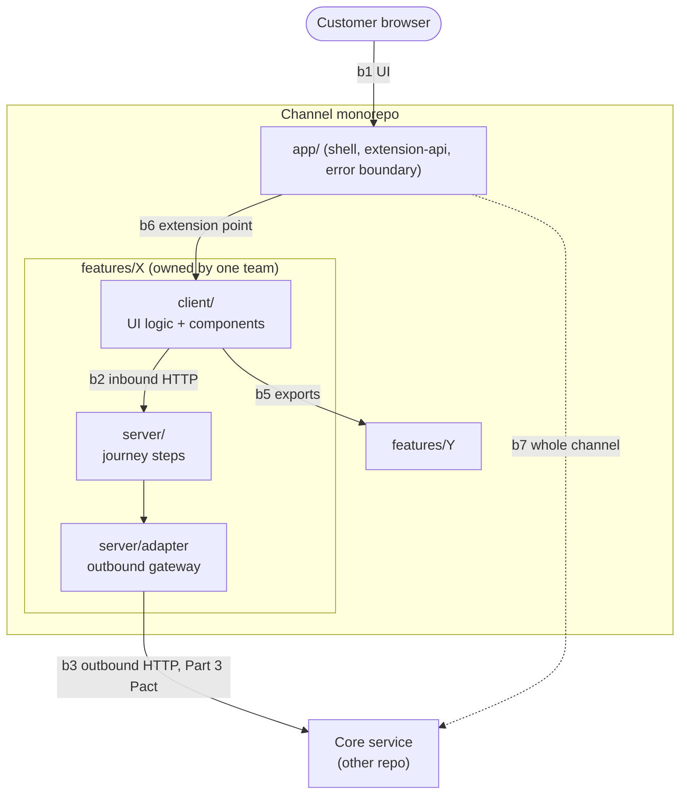

Parts 1-3 gave every boundary of a service a named test. This page does the same for the channel layer: which boundaries exist in the monorepo, which test belongs to each, what is real and what is replaced, who owns it, and when it runs in a trunk-based flow.

The core services keep their own suites (Parts 1-3). Nothing here replaces them; the channel tests assume them.

## The Boundaries

| # | Boundary | Test name | Real | Replaced | Owner | Page section |
|---|---|---|---|---|---|---|
| 1 | UI logic and components | **Component test** (real browser) | Component, design system, feature state logic, browser rendering | Adapters, by fakes or by a mocked network | Feature team | [Component](#1-component-test) |
| 2 | Client to channel server (same feature) | **Inbound gateway test (HTTP)** | Server route, validation, error mapping | Journey step / adapter | Feature team | [Inbound](#2-inbound-gateway-test-http) |
| 3 | Channel server to core service | **Outbound gateway test (HTTP)** | Adapter, HTTP client | Core service, by contract mock; slow/failing stub for timeouts | Feature team (consumer) | [Adapter](#3-outbound-gateway-test-http-adapter) |
| 4 | Journey steps (server side orchestration) | **Journey step test** | Step logic, state transitions | Adapters, by fakes | Journey owner | [Steps](#4-journey-step-test) |
| 5 | Feature to feature | **Export contract test** + static boundary check | Exported component or function, as the consumer uses it | The providing feature's internals | Both sides | [Exports](#5-export-contract-test-and-boundary-check) |
| 6 | Platform to feature | **Extension-point conformance test** | Shell, a feature's registration | The feature's pages (stubbed content) | Platform | [Extension](#6-extension-point-conformance-test) |
| 7 | Whole channel | **Closed-box channel test** | Shell, all features, channel server | Core services, by static stubs | Platform (harness) + each team (its scenarios) | [Closed-box](#7-closed-box-channel-test) |
| 8 | Cross-team journey | **Journey check** | As (7), for one named journey | As (7) | Journey owner | [Journey](#8-journey-check) |
| 9 | Cross-cutting guarantees | **Platform guarantee checks** | Shell + every feature | Core services | Platform | [Guarantees](#9-platform-guarantee-checks) |

Same rule as Part 1: *things owned by someone else are never real.* Core services are contract mocks or static stubs. The monorepo's own pieces run for real.

## 1. Component test

**Proves:** the component renders every state (loading, ready, empty, error, degraded) and emits the right events for the inputs it is given.
**Cannot catch:** whether adapters return what the component assumes (boundary 3), or whether the shell renders it correctly (boundary 6).

- Real: the component, the design system, the feature's client state logic, and a real browser. Layout, focus, real events and CSS only exist in a browser, so jsdom is kept for pure logic and for a few fast tests.
- Replaced: adapters, by fakes that return the typed outcomes from [failure and degradation](/patterns/across-teams/failure-and-degradation/), or, better where practical, the network itself (see [web additions](#web-specific-additions)) so the real adapter code runs. A replacement is justified: the real collaborator is a network call.
- Find elements as a user would (by role and label). The tests then double as an accessibility signal and survive refactors.
- This is where degraded states are tested, one test per state.
- Pure logic (price formatting, proration display, step order) is a domain-style test: no component, no replacement.

## 2. Inbound gateway test (HTTP)

**Proves:** the channel server route validates input, maps it to a journey step, and maps the outcome to a response with the right status and error code.
**Cannot catch:** whether the step does the right thing (4) or whether the client calls it correctly.

Client and server of one feature are owned by one team and released together, so a consumer-driven Pact is overhead. Share a schema (OpenAPI or JSON Schema, with generated types) between `client/` and `server/` inside the feature. A breaking change then fails compilation, and the route is tested against the same schema. If the client and server ever split owners or release separately, promote this to a Pact.

Optional on thin routes, as in Part 1: the closed-box channel test covers routing; create when validation or error mapping gets complex.

## 3. Outbound gateway test (HTTP): adapter

**Proves:** the adapter calls the core service as promised in the Pact, parses its responses, classifies failures (transient versus permanent, Part 2), and enforces timeouts.
**Cannot catch:** whether the real core service behaves like the mock (that is the provider verification in Part 3).

- Two halves, as in Part 1: a **contract mock** for shape and error responses; a **plain stub server** for timeouts and slow responses (a contract mock cannot delay).
- The consumer Pact is published to the broker from the feature's pipeline. Assert only the fields and error codes the adapter branches on (minimal critical specification).
- This is the boundary that makes "separate repos, one team" work: the owning team sees breakage from the broker the same day, in either direction.

## 4. Journey step test

**Proves:** the server-side steps of a journey (create charge, poll outcome, confirm enrolment) move through the states of the pending-charge model correctly, including retry with the same idempotency key.
**Cannot catch:** wire details of the adapters or UI rendering.

- Real: step logic and state transitions.
- Replaced: adapters, by fakes. The Part 1 [use-case test](/patterns/inside-a-service/use-case/) replaces only a failing save because it has a real database; the channel has no domain database, so there is nothing real to keep except the logic.
- If the journey keeps state (a draft checkout, a session), that storage is a persistence boundary with its own test, run against a real container as in Part 1.

## 5. Export contract test and boundary check

Two checks, different jobs.

**Static boundary check** (fast, every pre-push): fails when a feature imports another feature's internals or when anything imports past an `index.ts`. Proves nothing about behaviour, only about reaching past the line.

**Export contract test** (component level): when Payments exports a payment-method component to Subscriptions' checkout, the consumer (Subscriptions) asserts what it relies on:

| Aspect | Example assertion |
|---|---|
| Inputs | accepts `customerId`, `onSelected`; works without optional `preselectedId` |
| Outputs | emits `selected(paymentMethodId)` and `cleared()`, nothing else relied on |
| States | renders `loading`, `empty`, `error`, `ready`; reports `error` through its event, not by throwing |
| Embedding | respects the design-system container, no global styles leak |

The provider (Payments) runs these against its component. They follow the interaction mode ([team interaction patterns](/patterns/across-teams/team-interaction-patterns/)): while the pairing is in collaboration, these can be written together and shared; once X-as-a-Service, the consumer owns the assertions and the provider verifies them.

## 6. Extension-point conformance test

**Proves:** a feature's registration (pages, route metadata, context needs) still satisfies the shell's expectations, and the shell still provides the context features rely on.
**Cannot catch:** page content.

Owned by the platform. It is parameterised over every registered feature, so a new team gets the check by registering. A broken registration names the feature and the offending field. Because the platform is X-as-a-Service to the features, this check is what lets feature teams commit without talking to the platform.

## 7. Closed-box channel test

**Proves:** shell, features, and channel server work together for one behaviour at a time: a request enters the shell, a page renders, a server call is made, the result appears.
**Cannot catch:** anything about the core services (static stubs replace them).

- Real: everything in the monorepo.
- Replaced: core services, by static in-process stubs.
- Same limits as Part 1's [closed-box test](/patterns/inside-a-service/closed-box-test/): one behaviour per test, far fewer than component tests, rule combinations tested lower down.
- Ownership: the platform owns the harness (booting the channel, stub wiring). Each team owns the scenarios for its own feature in its own folder. No scenario spans two teams' features; that is the next one.

## 8. Journey check

**Proves:** a named journey that spans teams works through the seams, e.g. "subscribe and pay" through plan choice, payment-method component, confirm, processing, active.
**Cannot catch:** real core service behaviour (Part 5 and the Part 3 gates).

- It is the closed-box channel test applied to one journey crossing two features.
- **One owner: the journey owner** (Subscriptions for "subscribe and pay").
- **Few**: the happy path, plus one per major error scenario (declined card, Payments unavailable, pending that arrives late). This follows Part 1's rule of thumb.
- It is the only test where two feature teams' code runs together, so it is a permanent collaboration surface. Keep it small for that reason (team and test boundaries).

## 9. Platform guarantee checks

**Proves:** cross-cutting promises hold for every feature: accessibility floor, correlation id propagated on every adapter call, error boundary contains a thrown page, telemetry shape, performance budget, security policy. See [web-specific additions](#web-specific-additions).
**Cannot catch:** feature-specific correctness.

Run across all registered features, owned by the platform. These are the checks that let the platform say "this is guaranteed" without reviewing every commit. When a check fails, it names the feature and the team.

## Web-Specific Additions

Parts 1-3 had no browser. The channel does, and it brings concerns that need their own checks. Some sharpen the boundaries above; some are new.

### Sharpened boundaries

| Approach | Where | Recommendation |
|---|---|---|
| **Component tests in a real browser** | #1 | Adopt. Keep jsdom for pure logic only. |
| **Network-level mocking** (a service-worker mock) generated from the Pact or schema | #1, #7 | Adopt for the client. Real client and adapter code runs, and mocks cannot drift from the contract (Part 3's mock-drift problem). |
| **Shared schema and generated types** | #2 | Adopt. Pact stays the contract for #3, the core service. |
| **User-centric queries** (by role and label) | #1 | Adopt as a convention. |

### New test types

| Test | Proves | Owner | Runs |
|---|---|---|---|
| **Automated accessibility check** (in component and closed-box tests) | The accessibility floor holds. Partial: automated tools catch only a share of issues, so this is a floor, not a guarantee. | Platform sets rules; features inherit | Pre-push, trunk |
| **Visual regression** | A design-system component did not change visually by accident | Platform, design system only | Trunk |
| **Performance budgets** (bundle size per feature, lab Core Web Vitals) | One team's feature did not make the shared page slow. Matters most in a shared deploy. | Platform sets the budget; each team owns its slice | Trunk |
| **Cross-browser smoke** | The journey works in the few browsers customers use | Journey owner | Trunk, small |
| **Feature-flag combination check** | Flags used for trunk-based work do not create a broken combination | Each team for its flags | Trunk |
| **Hydration / SSR check** (if the shell renders on the server) | Server and client markup agree | Platform | Trunk |
| **Security headers and CSP check** | The shell's policy does not block a feature's needs, e.g. a hosted card-entry frame | Platform with Payments | Trunk |

Each new test names its owner and a level. The performance budget in particular is how a shared deploy stays fair: a feature that exceeds its slice fails its own check, and the failure names the team.

### Production signals

On the web, behaviour in production tells you things no pipeline can. These pair well with trunk-based releases and belong to Part 5/6:

- **Synthetic journey** against production with a test account, on a schedule.
- **Real user monitoring and client error tracking**, tagged by feature and team.
- **Progressive rollout with automatic rollback** on error-rate or vitals regression.

### Deliberately not added

- Per-page screenshot tests: maintenance cost, little signal beyond the design system's visual tests.
- Full browser journeys against real core services in the pipeline: the shared-E2E bottleneck again (Part 5).
- Micro-frontend compatibility tests: only if the channel later splits into independent deploys (see [monorepo](/patterns/across-teams/monorepo/)).

## What Does Not Get a Test Here

| Candidate | Decision | Reason |
|---|---|---|
| Domain rules (proration, retries, card limits) | Tested in the core services | They live in Parts 1-3 |
| Core service behaviour behind the adapter | Not tested in the channel | Provider verification, Part 3 |
| Full browser run against real core services in the pipeline | Not by default | That is Part 5; slow, flaky, shared bottleneck |
| Pixel-level visuals for every page | Design system only (visual regression) | Feature pages inherit the components; per-page screenshots multiply maintenance |
| Duplicate checks of the same behaviour at several levels | Avoid | Pick the lowest level that can prove it |

## Coverage Model: Blind Spots and Handoffs

| Layer | Proves | Cannot catch |
|---|---|---|
| Component | UI states and events | Adapter and shell behaviour |
| Inbound gateway | Route mapping | Step correctness |
| Journey step | State transitions, idempotent retry | Wire details |
| Outbound gateway (Pact) | Calls shaped as promised, failures classified | Real service behaviour |
| Export contract | Feature-to-feature agreement | Anything inside either feature |
| Extension-point conformance | Shell can host the feature | Page content |
| Closed-box channel | Pieces work together per behaviour | Core services |
| Journey check | Cross-team seam works | Real services |
| Platform guarantees (incl. accessibility, visual, performance, CSP) | Cross-cutting promises | Feature logic; accessibility only partly |
| **All of the above** | **The channel in isolation, against promised contracts** | **Whether deployed core services and the deployed channel really work together; production behaviour** |

The last row is the handoff to the Part 3 deploy gates (compatibility) and Part 5 (a minimal real end-to-end check).

## When Each Runs (Trunk-Based)

```mermaid
flowchart LR
    subgraph Pre["Pre-push (seconds to a minute)"]
        A["Component (browser), step, inbound gateway"]
        B["Static boundary check"]
        C["Adapter tests against contract mock"]
        A2["Accessibility check in component tests"]
    end
    subgraph Trunk["Trunk pipeline (minutes)"]
        D["Export contract, extension-point conformance"]
        E["Closed-box channel tests"]
        F["Publish Pacts, can-i-deploy"]
        G["Journey check, cross-browser smoke"]
        H["Platform guarantees: visual, performance budget, CSP, flags"]
    end
    subgraph Post["After release"]
        I["Synthetic journey, real user monitoring,<br/>progressive rollout (Part 5/6)"]
    end
    Pre --> Trunk --> Post
```

Pre-push stays fast so it can run before every commit; anything that needs the whole channel or the broker runs on trunk. A failure in the trunk pipeline stops the line ([ways of working](/patterns/across-teams/ways-of-working/)).

## Test Ownership and Interaction Mode

| Test | X-as-a-Service pairing | Collaboration pairing |
|---|---|---|
| Adapter / Pact | Consumer writes, core service verifies | Written together, then handed over |
| Export contract | Consumer feature writes, provider feature verifies | Written together while the component shape is found |
| Extension-point conformance | Platform writes, features pass | Platform and one feature design a new extension point together |
| Journey check | Journey owner writes; others contribute scenarios for their step | Not applicable; if you need constant collaboration, revisit ownership |
