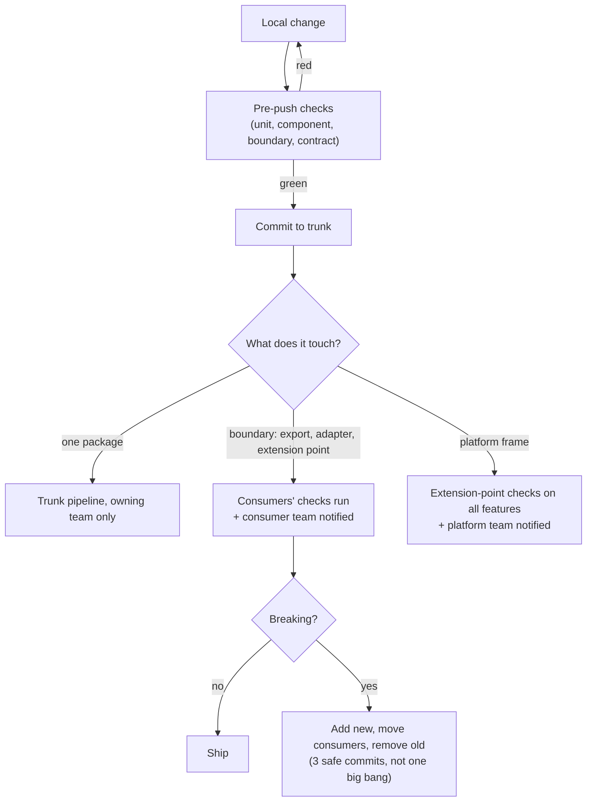
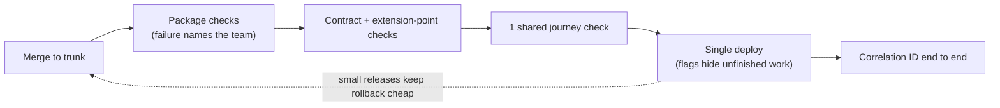

## Shared Deployment Is Not Shared Decision-Making

The channel is one repository and one deploy, so every team's feature ships together. The core services do not: Subscriptions and Payments release those on their own, through the [deployment gates](/patterns/between-services/deployment-gates/). This page is about the channel. The shared deploy is a fact about release mechanics. It must not become a fact about how decisions are made. The ways of working below are what keep a single codebase from turning into a single committee.

## Collaboration Default: Trunk-Based, No Pull Requests

Everyone commits small changes directly to trunk, many times a day. There is no pull-request gate and no long-lived branch. That removes a queue, but it also removes the place where review and ownership used to be enforced, so those must move elsewhere:

- **Before commit**: pairing or mobbing is the review. Risky boundary changes are worked on together, not approved afterwards.
- **At commit**: fast local checks (unit, component, boundary, contract) run before push. A failure is the author's to fix, not CI's to discover.
- **After commit**: the trunk pipeline runs everything else. A red trunk stops the line: the author fixes forward or reverts within minutes, before anyone else builds on it.
- **Afterwards, asynchronously**: teams read each other's boundary commits when notified. This is feedback, not permission.

## Ownership in the Repository

- Each package has a named owning team, recorded in an ownership manifest the tooling can read.
- A commit that touches only one package needs nobody else. The owning team just commits.
- A commit that touches a boundary (an export, an adapter, an extension point) runs the consumers' checks and **notifies the consumer team**. The checks are the gate; the notification is the courtesy.
- A commit that touches the platform frame runs the extension-point checks against every feature, and notifies the platform team.

The aim is that the common case needs no one's approval and the rare case, a boundary change, is caught by checks and announced automatically. Nobody has to remember who to ask, and nobody waits for a reviewer.

## Making a Change

A team usually has two places to change: its core service (own repo, own release) and its channel feature (monorepo, shared release).

**Inside your package**: change it, test it, ship it.

**At a boundary, backwards compatible** (for example, adding an optional field or a new export): ship it. The rule from [deployment gates](/patterns/between-services/deployment-gates/) applies: the provider can go first because existing consumers are unaffected.

**At a boundary, breaking**: this needs agreement. Use the same approach as for services, expressed as team behaviour:

1. The changing team states the intent early, in the open, with the proposed new shape, and ideally pairs with someone from the affected team.
2. The affected team adds or updates their expectation of it.
3. CI shows what breaks and for whom.
4. The change is split so each step is safe on its own (add the new, move consumers, remove the old).

Inside the channel monorepo, step 4 is easier than across services, since both sides can change in one commit. (Changes to a core service API still follow the [deployment gates](/patterns/between-services/deployment-gates/).) It is tempting to do a big-bang change for that reason. Resist it. A big-bang commit forces two teams to change, test, and release in lockstep, which is the coupling this structure is meant to avoid.

## Feedback Without Pull Requests

- **Pair or mob on what is risky.** A second person at write time beats a reviewer after the fact. Boundary changes are the default candidates.
- **Let the contract be the reviewer of boundaries.** Checks answer "can the other side keep working?" far faster than a person reading a diff.
- **Keep commits small.** A small commit is easy to understand, easy to revert, and keeps trunk releasable.
- **Read each other's boundary commits afterwards.** A consumer's question is "can I keep working?", not "would I have written it this way?". Concerns become a follow-up commit or a conversation, not a block.
- **Hide unfinished work behind flags**, not branches.

## Release

One channel deploy means one shared channel pipeline (core services keep theirs). To keep that from becoming a shared bottleneck:

- **Small commits to trunk, behind flags where needed.** A team can commit work that isn't ready for customers without blocking the release.
- **A red trunk is everyone's top priority.** Fix forward or revert at once; nobody else commits on top of a broken build.
- **The pipeline is the platform's product.** It should be fast and give clear ownership of failures: a failing package check names the team.
- **A failure in one package should not hold up unrelated work.** If a team's tests are flaky and block everyone, that is an incident for that team to fix first.
- **Rollback is a pipeline capability, not a negotiation.** Because the channel deploy is shared, rolling back reverts every team's channel changes in that release. Small, frequent releases keep that cost low. A channel rollback must also be safe against the core services currently in production, which the "can I deploy?" check covers in both directions. Rolling back a core service is a separate decision for its team.

## Testing Responsibilities

| Level | Owner | Purpose |
|---|---|---|
| Unit and component tests | Each team, in its package | Domain rules and UI behaviour |
| Contract tests | Both sides of each boundary | Server contracts, component and export contracts |
| One shared journey check | The journey owner (Subscriptions for "subscribe and pay") | Prove the seams work together |
| Platform checks | Platform team | Extension points still satisfy the shell |

Keep the shared journey checks few. Each one is a place where two teams' work can fail together and where blame is ambiguous.

## Incidents

An incident during checkout could be Subscriptions, Payments, the platform, or the seam between them. The practices that make this tractable:

- **One correlation ID** from the shell through every server call, provided by the platform's observability defaults.
- **One on-call route per journey**: the journey owner is first responder and pulls in others with evidence.
- **Blameless review that looks at the boundary**: the usual finding is not that a team made a mistake but that an assumption at the seam was unwritten. The fix is to write it down and check it.
- **Contracts updated after incidents**: if an incident revealed an unstated expectation, add it to the contract so it cannot recur.

## Cadence and Communication

- A short, regular platform sync so feature teams can raise friction and the platform can announce changes to extension points.
- Boundary changes announced in a single, visible place with the date, the owner, and what consumers must do.
- Collaboration periods time-boxed and named (see [team interaction patterns](/patterns/across-teams/team-interaction-patterns/)), so it is clear when they end.
- A periodic look at the team structure itself. If a pairing is constantly in collaboration mode, or a boundary keeps moving, that is a signal to reconsider ownership, not to add more meetings. This is the Inverse Conway Maneuver applied continuously.

## Warning Signs

- Teams avoid changing code in another package "because it's faster than asking". Boundaries are eroding.
- Commits to one package keep breaking other teams' checks. Ownership is unclear or packages are too tangled.
- Long-lived branches or informal "please look at this first" requests appear. Trunk-based discipline is slipping, usually because the checks are not trusted.
- Release meetings exist. The pipeline is not giving enough information to decide.
- The shared journey checks keep growing. Contracts are not carrying their weight.
- The platform team is the most frequent co-author or fixer on feature commits. The platform is thickening.

## The Short Version

Share the channel repository and its pipeline; keep core services separate. Do not share decisions that belong to one team. Make boundaries explicit, small, and checked in CI. Name one owner for each journey. Use the cheapest interaction mode that works and change it when it stops working.
