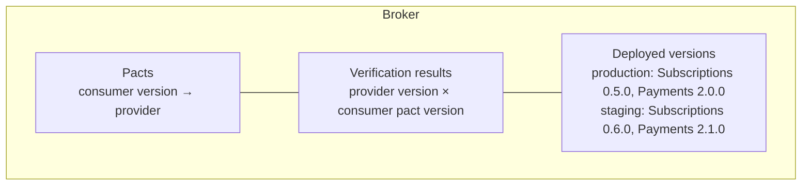

## What a pact is

A pact is a file generated by a consumer's own tests. The consumer runs its real code (the gateway, the webhook handler) against a mock built from an example interaction. The mock returns exactly what the test says. The recorded interaction is written to a JSON file. The provider then replays each recorded interaction against its real code and compares what it produces.

```
1. Consumer test states an example: "when I send this request, I expect this response"
2. The consumer's real code runs against a mock built from that example
3. The example is written to a pact file
4. The pact is published to the broker, tagged with the consumer's version and branch
5. The provider fetches the pacts that apply to it and replays them against its real code
6. The result (pass or fail) is published to the broker, tagged with the provider's version
```

Two things follow from this. The consumer's mock cannot drift from the provider's behaviour without a verification failing, because the mock *is* the recorded example. And a pact says nothing about fields the consumer does not mention, which is what leaves the provider free to change them.

## Subscriptions: calling Payments

The consumer test is the same one shown in Part 1's [gateway page](/patterns/inside-a-service/outbound-http-gateway/#the-payments-gateway). It lists only what the gateway sends and reads:

```javascript
// code-examples/pact-tests/subscriptions-consumer.spec.js (excerpt)

await provider
  .addInteraction()
  .given('a subscription can be charged')
  .uponReceiving('a charge request')
  .withRequest({
    method: 'POST',
    path: '/charges',
    headers: { 'Content-Type': 'application/json' },
    body: {
      subscriptionId: like('sub-1'),
      idempotencyKey: like('sub-1:2026-11'),
      amount: integer(999),
      currency: like('usd'),
    },
  })
  .willRespondWith({
    status: 201,
    body: { chargeId: like('ch-1'), status: 'pending' },
  })
  .executeTest(async (mock) => {
    const result = await requestCharge(aChargeRequest(), clientFor(mock.url));
    expect(result).toEqual({ type: 'accepted', chargeId: 'ch-1' });
  });
```

The response lists `chargeId` and `status` because the gateway reads them. If Payments also returns `createdAt`, nothing changes.

## Subscriptions: reading the webhook

The webhook is Payments calling Subscriptions, but Subscriptions is the one that *reads* the body, so Subscriptions writes the pact. It is a message contract, so the pact describes the body, not the HTTP call.

```javascript
// code-examples/pact-tests/subscriptions-consumer.spec.js (excerpt)

await messagePact
  .expectsToReceive('a PaymentOutcome webhook')
  .given('a renewal charge was declined')
  .withContent({
    eventId: like('evt-1'),
    chargeId: like('ch-1'),
    subscriptionId: like('sub-1'),
    outcome: 'failed',
    failureReason: like('card_declined'),
    occurredAt: datetime("yyyy-MM-dd'T'HH:mm:ss.SSSX", '2026-11-01T10:00:00.000Z'),
  })
  .verify(async (message) => {
    const body = JSON.stringify(message.contents);
    expect(await handlePaymentOutcome(sign(body), body)).toBe(200);
  });
```

`like` states the *type*, not the value, so Payments is not forced to send `ch-1`. Fields Subscriptions does not read (`amount`, `currency`) are absent.

Do not pin more than the code depends on. A pact that asserts the exact wording of an error message, or requires fields the handler ignores, makes harmless provider changes fail verification. Assert how an error looks (its code), not why it happened.

## Payments: verifying

Payments does not write pacts for Subscriptions. It replays them.

```javascript
// code-examples/provider-verification/payments-verify.spec.js (excerpt)

// HTTP: replay Subscriptions' request against the real route
await new Verifier({
  provider: 'Payments',
  providerBaseUrl: server.url,
  pactBrokerUrl: process.env.PACT_BROKER_URL,
  consumerVersionSelectors: [
    { mainBranch: true },
    { matchingBranch: true },
    { deployedOrReleased: true },
  ],
  stateHandlers: {
    'a subscription can be charged': async () => resetDb(),
  },
  publishVerificationResult: true,
  providerVersion: process.env.GIT_COMMIT_SHA,
  providerVersionBranch: process.env.GIT_BRANCH,
}).verifyProvider();

// Message: produce the body Payments would send, and compare
await new MessageProviderPact({
  provider: 'Payments',
  pactBrokerUrl: process.env.PACT_BROKER_URL,
  consumerVersionSelectors: [{ mainBranch: true }, { deployedOrReleased: true }],
  messageProviders: {
    'a PaymentOutcome webhook': async () =>
      toWebhookPayload(aCharge({ status: 'failed', failureReason: 'card_declined' })),
  },
  publishVerificationResult: true,
  providerVersion: process.env.GIT_COMMIT_SHA,
}).verify();
```

The selectors decide which consumer versions Payments must satisfy: whatever is on the consumer's main branch, a consumer branch with the same name as this one, and *every consumer version currently deployed or released anywhere*. The last one is what makes the gate meaningful. It means "replay the pacts of the consumers that are actually running".

**Provider states.** Each `given` becomes a function that puts the provider into the right condition before replay (`'a subscription can be charged'` resets the database and creates a chargeable subscription). They are the part of a provider setup that takes real effort and the reason this approach needs control of both sides.

## What a pass proves

A passing verification proves the sender's real code produces, for the stated state, a message that has the fields and types the reader said it uses, with the stated status. It does **not** prove:

- that the side effect happened (the charge exists, the row is committed before the webhook is sent)
- anything about timing, ordering or retry behaviour
- that the reader handles values the pact did not mention, such as a new enum value
- that two different services agree about meaning, only that they agree about shape and the examples they chose

Those are behaviour, and behaviour is tested inside each service. The pact moves the *shape* of the agreement out of two people's heads and into a file both pipelines run.

## The broker

The broker stores:

- every published pact, by consumer version and branch
- every verification result, by provider version
- which version of each service is **recorded as deployed in each environment** (`production`, `staging`)

So each environment has its own set of contracts in force: the pacts of the consumer versions live there, and the verification results of the provider version live there. These are the same versioned contracts viewed per environment, not separate contracts per environment. A request in production is judged against production's versions, and a request in staging against staging's.



## Who writes, who runs

| Pair | Writes the pact | Verifies it |
|---|---|---|
| Subscriptions ↔ Payments, `POST /charges` | Subscriptions | Payments |
| Subscriptions ↔ Payments, webhook body | Subscriptions | Payments |
| Subscriptions ↔ Inventory, reservations | Subscriptions | Inventory |
| Subscriptions ↔ Accounts, `AccountClosed`, and Accounts reading `SubscriptionRenewed` | the reader in each case | the sender in each case |
| Payments ↔ the processor | Payments (as a mock only) | nobody; scheduled learning tests against the sandbox |

Reading the table top to bottom: **readers publish first, senders verify**.

## Where this model does not fit

The model needs both sides inside the same group of teams, a small number of consumers, and a provider that can put itself into a given state. It is a poor fit for a public API with consumers nobody can identify, and for a provider whose data cannot be controlled. That is why the processor sits outside it.

## Next: contract drift

Read [contract-drift.md](/patterns/between-services/contract-drift/) to see what happens when a pact changes.
