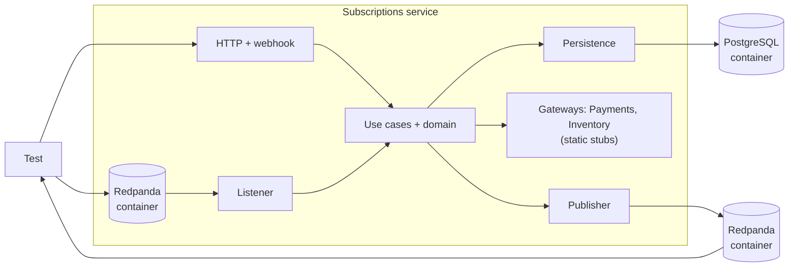

The earlier tests check the parts. Bugs often sit in the connections.

The domain works. The route works. The listener works. The query works. Then everything runs together and something is off. Maybe the webhook handler passes `occurredAt` as a string and the use case expects a date. Maybe the route reads a field the use case no longer fills. These problems only appear when the whole service runs.

A closed-box test treats the service as the box. It enters through a real edge, an HTTP request or a message, and checks what comes out of another edge: a response, stored state, a published message.

## What "closed box" means

The test does not look inside. Given a message or a request, what does the service do? If the domain is refactored, these tests should still pass, because the behaviour is the same.

"Closed" also describes what is replaced: only things owned by someone else. Remote services such as Inventory and Payments are substituted by static, in-process implementations. The database and the broker belong to this service, so they run for real, in containers. Everything between the edges runs for real too.

## The right level of confidence

- [Domain tests](/patterns/inside-a-service/domain/) say the rules are right.
- [Use case tests](/patterns/inside-a-service/use-case/) say loading, deciding and storing are connected.
- [Inbound HTTP](/patterns/inside-a-service/inbound-http-gateway/) and [messaging](/patterns/inside-a-service/inbound-messaging/) tests say each entry point maps correctly.
- [Persistence tests](/patterns/inside-a-service/persistence/) say the queries work.
- [Outbound gateway tests](/patterns/inside-a-service/outbound-http-gateway/) say the calls to others are shaped as agreed.
- Closed-box tests say all of that works **together**, for one behaviour at a time.

## Keeping the number small

Closed-box tests are slower than the rest and cover many layers at once. When one fails, the cause could be in any layer. Rainsberger's warning about tests that depend on many pieces of behaviour applies here. The limits that keep them useful:

- **One behaviour per test**, named in the product's words: "failed renewal puts the subscription in grace".
- **No combinations.** Variations of a rule (leap days, plan changes) belong in the domain tests.
- **One service.** Neighbours are always stubbed. Testing across services is Part 3's contracts and Part 5's few end-to-end journeys.
- **Far fewer than domain tests.** As a rule of thumb: one closed-box test per happy-path user journey, plus one per major error scenario involving multiple components (e.g., a remote service is unavailable). A ratio of 1:3 or 1:4 (closed-box to domain tests) is typical. If the suite grows toward the size of the domain suite, move cases down: most of what is being tested belongs in the layers below.



## The design

The test starts the service in process, using the same containers as the lower-level tests. Only the Inventory and Payments gateways are swapped for static ones.

```typescript
// test/closed-box/harness.ts

export async function startService() {
  await resetDb();                                      // same Postgres container as the other tests
  const server = Bun.serve({ ...serverDefinition, port: 0 });
  const listeners = await startListeners();             // real consumers on the Redpanda container

  return {
    api: (path: string, init?: RequestInit) => fetch(new URL(path, server.url), init),
    webhook: (body: unknown) =>
      fetch(new URL("/webhooks/payment-outcome", server.url), {
        method: "POST",
        headers: { "x-signature": sign(JSON.stringify(body)) },
        body: JSON.stringify(body),
      }),
    chargesRequested: () => staticPayments.requests(),   // what the static Payments gateway recorded
    send: (topic: string, value: unknown, key: string) =>
      producer.send({ topic, messages: [{ key, value: JSON.stringify(value) }] }),
    published: collectFrom,                              // test consumer on the same broker
    stop: async () => { server.stop(); await listeners.stop(); },
  };
}
```

```text
# .env.test

INVENTORY_GATEWAY=static
PAYMENTS_GATEWAY=static
```

## Testing

Tests describe behaviours. Each enters through a real edge and leaves through a real edge.

```text
// Application architecture concept:
//   Edge -> Domain -> Persistence / Gateways -> Edge
//
// Test boundary implementation:
//   fetch / producer -> everything -> PostgresContainer + staticGateway + RedpandaContainer
```

```typescript
// test/closed-box/renewal.test.ts

describe("closed box: renewal", () => {
  let service: Awaited<ReturnType<typeof startService>>;
  beforeEach(async () => { service = await startService(); });
  afterEach(() => service.stop());

  it("a failed renewal payment puts the subscription in grace", async () => {
    const id = await startSubscriptionVia(service, { planId: "pln-monthly", userId: "usr-1" });

    const response = await service.webhook({
      eventId: "evt-1",
      chargeId: "ch-1",
      subscriptionId: id,
      outcome: "failed",
      amount: 999,
      currency: "usd",
      occurredAt: "2026-11-01T10:00:00Z",
    });
    expect(response.status).toBe(200);

    await eventually(async () => {
      const response = await service.api(`/subscriptions/${id}`);
      expect(await response.json()).toMatchObject({
        status: "past_due",
        graceEndsOn: "2026-11-04T10:00:00.000Z",
      });
    });
  });

  it("a customer cannot cancel the same subscription twice", async () => {
    const cancelled = service.published("subscriptions.subscription-cancelled");
    const id = await startSubscriptionVia(service, { planId: "pln-monthly", userId: "usr-1" });

    const first = await service.api(`/subscriptions/${id}/cancel`, { method: "POST" });
    const second = await service.api(`/subscriptions/${id}/cancel`, { method: "POST" });

    expect(first.status).toBe(200);
    expect(second.status).toBe(409);
    expect(await cancelled.next(1)).toHaveLength(1);
    expect(await cancelled.noMoreWithin(500)).toBeTrue();
  });

  it("an out-of-stock product prevents a subscription from starting", async () => {
    const response = await service.api("/subscriptions", {
      method: "POST",
      body: JSON.stringify({ planId: "pln-monthly", userId: "usr-1", sku: "out-of-stock-sku" }),
    });

    expect(response.status).toBe(409);
    expect(service.chargesRequested()).toHaveLength(0);
  });

  it("a due renewal asks Payments for exactly one charge, even if the job runs twice", async () => {
    const id = await startSubscriptionVia(service, { planId: "pln-monthly", userId: "usr-1" });

    await service.runRenewalJob(new Date("2026-12-01"));
    await service.runRenewalJob(new Date("2026-12-01"));

    expect(service.chargesRequested()).toEqual([
      expect.objectContaining({ subscriptionId: id, idempotencyKey: `${id}:2026-12` }),
    ]);
  });
});
```

The first test touches every layer. The webhook is received over real HTTP, the use case loads from a real database, the domain applies the rule, the result is stored, and an HTTP read shows it. The second checks that the rule holds across the edge and that exactly one event leaves.

Because the database and the broker are real, assertions about "nothing was published" need a short wait. Keep those waits small and few; they are the main cost of this style.

## In-process and out-of-process

The version above runs the service in the test process against real containers. Failures are easy to debug, and the behaviour is shown to be wired together. It does not prove the built artifact starts, reads its configuration, or has the right health check.

Add a few **out-of-process** tests of the same shape that start the built service as another container on the same network. Three are enough: startup, a happy path, a failure path.

## What this test cannot catch

Anything about the real Inventory, Payments or Accounts. The static gateways return what the test author expects, and the test posts the webhook body the author believes Payments sends. If Payments changes its webhook or its `/charges` answer, these tests keep passing. The contract tests in Part 3 are what notice.

### Tools used

- [Testcontainers][tc] — PostgreSQL and Redpanda, shared with the lower-level tests
- [Bun test][bun_test] — test runner and HTTP server
- Static gateway — fixed Inventory data, no network calls

[tc]: https://testcontainers.com
[bun_test]: https://bun.sh/docs/cli/test
