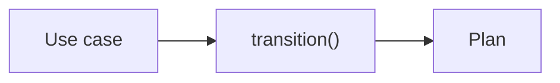

Subscriptions are mostly rules. When does a renewal happen? What if the payment fails? How long is the grace period? Can a cancelled subscription be restarted?

Without a boundary around those rules, they spread out. The grace period gets checked in a route handler, again in a message listener, and a third time in the nightly job. A simple question, "what happens if payment fails twice?", needs three files to answer.

The domain holds the rules in one place. Everything else in the service is there to deliver requests to it and to store what it decides.

## One responsibility

Domain code encodes the rules. It does not know whether a request arrived over HTTP, as the Payments webhook or as an `AccountClosed` message. It does not know which broker is in use, how data is stored, or what Inventory's API looks like.

That matters when delivery changes. A payment failure arrives by webhook today and could arrive as a broker message next year. The rule "a failed payment starts a grace period" stays the same.

It also matters for the team and its product people. When the rules are in one readable place, the people who understand the business can read them directly.

## Easy to test

Domain functions take values and return values. They never fetch or save anything. Loading a subscription and storing the outcome is the job of the [use case](/patterns/inside-a-service/use-case/), which wraps the domain.

So domain tests need nothing: no server, no database, no container. They call the function and check the result. They read like the rule:

> _"A failed renewal payment puts an active subscription into a grace period of the length the plan defines."_

Domain tests are **sociable**. When domain objects collaborate, such as a `Subscription` and its `Plan`, the test uses the real ones. Doubles are not needed anywhere in the domain, because there is nothing outside it to replace. A test that wants one is pointing at a missing concept.



## The design

The domain is a state machine. Given the current state, the plan and an action, what is the next state? Every outcome is a typed result, so there are no hidden errors.

Other domain logic lives elsewhere in the module: plan validation, grace period calculation, and any rules about renewal timing. The page focuses on `transition()` as the primary decision point. Other domain functions follow the same pattern: pure functions, no dependencies, one rule per function.

```typescript
// src/subscription/subscription.ts

export type Subscription = {
  id: string;
  userId: string;
  planId: string;
  startDate: Date;
  renewOn: Date;
  graceEndsOn?: Date;
  status: "active" | "past_due" | "cancelled" | "ended";
};

export type Plan = { id: string; interval: "month" | "year"; graceDays: number };

export type SubscriptionAction =
  | { type: "payment-failed"; at: Date }
  | { type: "payment-succeeded"; at: Date; nextRenewOn: Date }
  | { type: "grace-expired"; at: Date }
  | { type: "cancel"; at: Date };

export const SubscriptionErrors = {
  NotFound: { code: "sub-2", message: "subscription not found" },
  InvalidTransition: { code: "sub-4", message: "action not allowed in this state" },
  UnableToSave: { code: "sub-3", message: "unable to save subscription" },
};

export function transition(
  subscription: Subscription,
  plan: Plan,
  action: SubscriptionAction,
): Result<Subscription, SubscriptionError> {
  switch (subscription.status) {
    case "active":
      switch (action.type) {
        case "payment-failed":
          return ok({
            ...subscription,
            status: "past_due",
            graceEndsOn: addDays(action.at, plan.graceDays),
          });
        case "payment-succeeded":
          return ok({ ...subscription, renewOn: action.nextRenewOn });
        case "cancel":
          return ok({ ...subscription, status: "cancelled" });
      }
      break;
    case "past_due":
      switch (action.type) {
        case "cancel":
          return ok({ ...subscription, status: "cancelled", graceEndsOn: undefined });
        case "payment-succeeded":
          return ok({
            ...subscription,
            status: "active",
            graceEndsOn: undefined,
            renewOn: action.nextRenewOn,
          });
        case "grace-expired":
          return ok({ ...subscription, status: "cancelled" });
      }
      break;
  }
  return err(SubscriptionErrors.InvalidTransition);
}
```

## Testing

The test calls the domain function. Nothing else is involved.

```text
// Application architecture concept:
//   DomainFn -> [DomainFn]
//
// Test boundary implementation:
//   transition -> (Plan)
```

Because tests are this cheap, this is where the cases go: every valid and invalid path through the state machine, edge cases like leap days, plan edge cases (zero grace days), repeated failures, and every invalid transition. Domain tests are the broadest—rule details that would be slow to provoke from outside (through HTTP or messages) are thoroughly covered here.

```typescript
// test/non-dom/subscription/subscription.test.ts

describe("subscription transitions", () => {
  const plan = aPlan({ graceDays: 3 });

  it("starts a grace period when a renewal payment fails", () => {
    const result = transition(
      aSubscription({ status: "active" }),
      plan,
      { type: "payment-failed", at: new Date("2026-11-01") },
    );

    expect(result._unsafeUnwrap()).toMatchObject({
      status: "past_due",
      graceEndsOn: new Date("2026-11-04"),
    });
  });

  it("uses the grace period the plan defines", () => {
    const result = transition(
      aSubscription({ status: "active" }),
      aPlan({ graceDays: 7 }),
      { type: "payment-failed", at: new Date("2026-11-01") },
    );

    expect(result._unsafeUnwrap().graceEndsOn).toEqual(new Date("2026-11-08"));
  });

  it("returns to active when a payment succeeds during grace", () => {
    const result = transition(
      aSubscription({ status: "past_due", graceEndsOn: new Date("2026-11-04") }),
      plan,
      { type: "payment-succeeded", at: new Date("2026-11-02"), nextRenewOn: new Date("2026-12-01") },
    );

    expect(result._unsafeUnwrap()).toMatchObject({
      status: "active",
      graceEndsOn: undefined,
      renewOn: new Date("2026-12-01"),
    });
  });

  it("cancels the subscription when the grace period expires", () => {
    const result = transition(
      aSubscription({ status: "past_due" }),
      plan,
      { type: "grace-expired", at: new Date("2026-11-04") },
    );

    expect(result._unsafeUnwrap().status).toBe("cancelled");
  });

  it("rejects a payment failure on a cancelled subscription", () => {
    const result = transition(
      aSubscription({ status: "cancelled" }),
      plan,
      { type: "payment-failed", at: new Date() },
    );

    expect(result._unsafeUnwrapErr()).toEqual(SubscriptionErrors.InvalidTransition);
  });
});
```

### What this test cannot catch

How a call arrives at the domain, how state is loaded and saved, and whether the pieces are wired together. Those belong to the [use case](/patterns/inside-a-service/use-case/), [inbound gateway](/patterns/inside-a-service/inbound-http-gateway/) and [messaging](/patterns/inside-a-service/inbound-messaging/) tests.

### Tools used

- [Bun test][bun_test] — test runner
- [neverthrow][neverthrow] — typed result values

[bun_test]: https://bun.sh/docs/cli/test
[neverthrow]: https://github.com/supermacro/neverthrow
