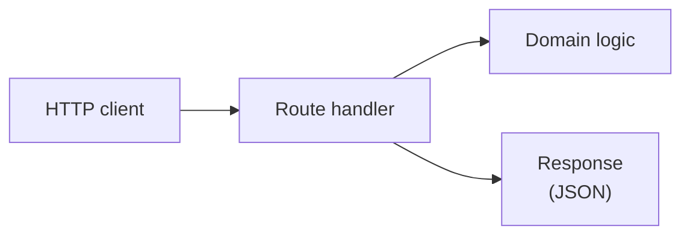

HTTP is one way to deliver a service. Subscriptions is also driven by messages, by the webhook Payments calls, and by a scheduled job. The rule "a cancelled subscription cannot be cancelled again" is the same in every case. Only the delivery differs.

The inbound HTTP gateway is the code that handles this delivery. It receives a request, calls a [use case](/patterns/inside-a-service/use-case/), and maps the result to a response. It makes no business decisions.

## One responsibility

A route handler knows three things:

- How to read incoming data (path parameters, JSON body)
- Which use case to call
- How to map the result to HTTP (status, headers, body)

When the use case returns `InvalidTransition`, the route decides that this is a `409`. That is HTTP knowledge. The business knowledge, that the transition is not allowed, stays in the domain.

If the route also decided whether cancellation is allowed, the message listener would need its own copy of the rule.

| Use-case result | HTTP response |
|---|---|
| ok | `200` with the subscription |
| `NotFound` | `404` |
| `InvalidTransition` | `409` |
| `UnableToSave` | `500` |
| malformed request | `400`, never reaches the use case |



## The design

The route parses the request at the edge. Data that does not match the schema is rejected before it reaches the use case.

```typescript
// src/subscription/web/cancel-route.ts

const cancelParams = z.object({ id: z.string().min(1) });

export async function cancelSubscription(req: BunRequest<"/subscriptions/:id/cancel">) {
  const params = cancelParams.safeParse(req.params);
  if (!params.success) return json({ code: "http-1", message: "invalid request" }, 400);

  return cancel(params.data.id, new Date()).match(
    (subscription) => json(toResponse(subscription), 200),
    (error) => json(error, statusFor(error)),
  );
}

const statusFor = (e: SubscriptionError) =>
  ({
    [SubscriptionErrors.NotFound.code]: 404,
    [SubscriptionErrors.InvalidTransition.code]: 409,
  })[e.code] ?? 500;
```

```typescript
// src/routes.ts

export const serverDefinition = {
  port: envConfig.PORT,
  routes: {
    "/subscriptions": { POST: startSubscription },
    "/subscriptions/:id": { GET: getSubscription },
    "/subscriptions/:id/cancel": { POST: cancelSubscription },
  },
};
```

## Testing

The test starts a real server. The use case is replaced with a spy that returns a chosen result. Real HTTP requests go to the running server.

```text
// Application architecture concept:
//   HTTP client -> HttpServer -> Domain
//
// Test boundary implementation:
//   fetch -> route -> mock(use case)
```

Controlling the use-case result lets the test reach every error mapping without arranging data. The domain and use case have their own tests; none are repeated here. There is no database in this test, so it stays fast.

```typescript
// test/non-dom/routes.test.ts

describe("http: cancel subscription", () => {
  let server: Bun.Server;
  beforeAll(() => { server = Bun.serve({ ...serverDefinition }); });
  afterAll(() => server.stop());

  const cancelRequest = (id: string) =>
    fetch(new URL(`/subscriptions/${id}/cancel`, server.url), { method: "POST" });

  it("returns the cancelled subscription", async () => {
    spyOn(cancelModule, "cancel").mockReturnValueOnce(ok(aSubscription({ status: "cancelled" })));

    const response = await cancelRequest("sub-1");

    expect(response.status).toBe(200);
    expect(await response.json()).toMatchObject({ status: "cancelled" });
  });

  it("returns 404 for an unknown subscription", async () => {
    spyOn(cancelModule, "cancel").mockReturnValueOnce(err(SubscriptionErrors.NotFound));
    expect((await cancelRequest("sub-nope")).status).toBe(404);
  });

  it("returns 409 when the subscription cannot be cancelled", async () => {
    spyOn(cancelModule, "cancel").mockReturnValueOnce(err(SubscriptionErrors.InvalidTransition));
    const response = await cancelRequest("sub-1");
    expect(response.status).toBe(409);
    expect(await response.json()).toMatchObject({ code: "sub-4" });
  });

  it("returns 400 without calling the use case when the request is malformed", async () => {
    const cancelSpy = spyOn(cancelModule, "cancel");
    const response = await fetch(new URL("/subscriptions/%20/cancel", server.url), { method: "POST" });
    expect(response.status).toBe(400);
    expect(cancelSpy).not.toHaveBeenCalled();
  });
});
```

## The Payments webhook

Subscriptions asks Payments to charge with `POST /charges` (see [gateway](/patterns/inside-a-service/outbound-http-gateway/)) and gets `pending` back. The answer, succeeded or failed, arrives later as a call from Payments to `POST /webhooks/payment-outcome`. To Subscriptions this is an inbound HTTP gateway like any other, with three extra concerns that a normal route does not have:

- **Authenticity.** Anyone can post to a public URL, so the route checks the signature header before reading the body.
- **Duplicates.** Payments retries any delivery that was not acknowledged, so the same `eventId` can arrive more than once. Applying a failure twice must not restart the grace period.
- **The status code is the retry signal.** `2xx` means "stop sending". `4xx` means "this will never work, give up". `5xx` means "try again later". The mapping from use-case results to status codes is therefore part of the contract, not a detail.

| Situation | Response | Payments then |
|---|---|---|
| Applied, or already applied (same `eventId`) | `200` | stops |
| Bad signature | `401` | stops and alerts |
| Malformed body | `400` | stops and alerts |
| Unknown subscription | `404` | stops and alerts |
| Could not save | `500` | retries later |

The handler is a plain function, like the messaging handler, so the delivery cases can be tested without a server. Checking the event id, applying the outcome and recording the id happen in one transaction. Without that, a crash between "applied" and "recorded" would apply the same outcome again on the retry.

```typescript
// src/subscription/web/payment-outcome-handler.ts

const paymentOutcomeSchema = z.object({
  eventId: z.string(),
  chargeId: z.string(),
  subscriptionId: z.string(),
  outcome: z.enum(["succeeded", "failed"]),
  amount: z.number(),
  currency: z.string(),
  occurredAt: z.coerce.date(),
  failureReason: z.string().optional(),
});

export async function handlePaymentOutcome(signature: string, raw: string): Promise<number> {
  if (!validSignature(signature, raw)) return 401;

  const parsed = paymentOutcomeSchema.safeParse(JSON.parse(raw));
  if (!parsed.success) return 400;
  const event = parsed.data;

  return inTransaction(async () => {
    if (await alreadyProcessed(event.eventId)) return 200;

    const result = event.outcome === "failed"
      ? await recordPaymentFailure(event.subscriptionId, event.occurredAt)
      : await recordPaymentSuccess(event.subscriptionId, event.occurredAt);

    return result.match(
      async () => { await markProcessed(event.eventId); return 200; },
      async (error) =>
        error.code === SubscriptionErrors.NotFound.code ? 404
        : error.code === SubscriptionErrors.InvalidTransition.code ? 200
        : 500,
    );
  });
}
```

An `InvalidTransition` is acknowledged with `200`. The outcome contradicts the subscription's current state (for example a failure for an already cancelled subscription), a retry would hit the same wall, and the fact has already been dealt with. Whether that should also raise an alert is a product decision, not a delivery one.

`alreadyProcessed` and `markProcessed` use the `processed_message` table from [persistence](/patterns/inside-a-service/persistence/), which holds event ids as well as message ids.

### Testing the webhook

Three tests, three questions, as for [messaging](/patterns/inside-a-service/inbound-messaging/).

**Contract test (the payload):** Subscriptions is the *reader* of the webhook body, so it writes down what it needs and Payments verifies that it sends it. This is a message contract: the body is the interaction, the HTTP delivery is not.

**Handler tests (delivery):** a real database, the use case replaced. They cover duplicates, a bad signature, a malformed body and a failed save.

**Route test (HTTP):** the real server, to prove the signature header is read and the handler's number becomes the response status.

```typescript
// test/non-dom/payment-outcome.consumer.test.ts

const provider = new PactV4({
  dir: resolve(process.cwd(), "pacts"),
  consumer: "subscriptions",
  provider: "payments",
  spec: SpecificationVersion.SPECIFICATION_VERSION_V4,
});

it("reads a failed payment outcome", async () => {
  await provider
    .addAsynchronousInteraction()
    .given("a renewal charge was declined")
    .expectsToReceive("a PaymentOutcome webhook")
    .withJSONContent({
      eventId: like("evt-1"),
      chargeId: like("ch-1"),
      subscriptionId: like("sub-1"),
      outcome: "failed",
      failureReason: like("card_declined"),
      occurredAt: like("2026-11-01T10:00:00.000Z"),
    })
    .executeTest(async (message) => {
      const useCase = spyOn(recordPaymentFailureModule, "recordPaymentFailure")
        .mockReturnValueOnce(okAsync(aSubscription()));
      const body = JSON.stringify(message.contents);

      const status = await handlePaymentOutcome(sign(body), body);

      expect(status).toBe(200);
      expect(useCase).toHaveBeenCalledWith("sub-1", new Date("2026-11-01T10:00:00.000Z"));
    });
});
```

The expectation lists only the fields Subscriptions reads. `amount` and `currency` are in the schema but not in the pact, so Payments is free to change them until Subscriptions starts to rely on them.

```typescript
// test/non-dom/payment-outcome-handler.test.ts

describe("webhook: payment outcome handler", () => {
  beforeEach(() => resetDb());

  const body = JSON.stringify({
    eventId: "evt-1", chargeId: "ch-1", subscriptionId: "sub-1", outcome: "failed",
    amount: 999, currency: "usd", occurredAt: "2026-11-01T10:00:00Z",
  });

  it("applies a repeated delivery only once", async () => {
    const useCase = spyOn(recordPaymentFailureModule, "recordPaymentFailure")
      .mockReturnValue(okAsync(aSubscription()));

    await handlePaymentOutcome(sign(body), body);
    const second = await handlePaymentOutcome(sign(body), body);

    expect(second).toBe(200);
    expect(useCase).toHaveBeenCalledTimes(1);
  });

  it("rejects a bad signature without calling the use case", async () => {
    const useCase = spyOn(recordPaymentFailureModule, "recordPaymentFailure");
    expect(await handlePaymentOutcome("sig_wrong", body)).toBe(401);
    expect(useCase).not.toHaveBeenCalled();
  });

  it("rejects a malformed body", async () => {
    expect(await handlePaymentOutcome(sign("{}"), "{}")).toBe(400);
  });

  it("answers 500, and does not record the event, when the save fails", async () => {
    spyOn(recordPaymentFailureModule, "recordPaymentFailure")
      .mockReturnValueOnce(errAsync(SubscriptionErrors.UnableToSave));
    expect(await handlePaymentOutcome(sign(body), body)).toBe(500);
    expect(await alreadyProcessed("evt-1")).toBeFalse();
  });
});
```

### What the webhook tests cannot catch

Whether Payments really sends this body and signs it the way we verify it. The pact is the evidence, and Payments verifies it (Part 3). Nor can they show that Payments retries as the table above assumes; that is Payments' own gateway behaviour (Part 2).

### When these tests become necessary

On a thin API with simple error mapping, the [closed-box test](/patterns/inside-a-service/closed-box-test/) already exercises routing and common error statuses. **Write these tests when:**

- **Error mapping is non-trivial:** More than two or three error codes, or the mapping logic is complex (e.g., different status codes for the same domain error depending on state).
- **Validation is complex:** Schema validation beyond presence checks, custom rules, or conditional validation.
- **Testing error paths through the whole service is expensive:** Mocking the use case here is faster than arranging data for the closed-box test.

Messaging listeners usually earn their own tests sooner, because duplicates and poison messages are hard to provoke from outside the listener.

### What this test cannot catch

Whether the use case actually returns the results the route expects. A renamed error code or changed result type passes here but fails in the closed-box test, making the closed-box test the canary for wiring issues.

### Tools used

- [Bun test][bun_test] — test runner and HTTP server
- [Zod][zod] — request schema validation

[bun_test]: https://bun.sh/docs/cli/test
[zod]: https://zod.dev
