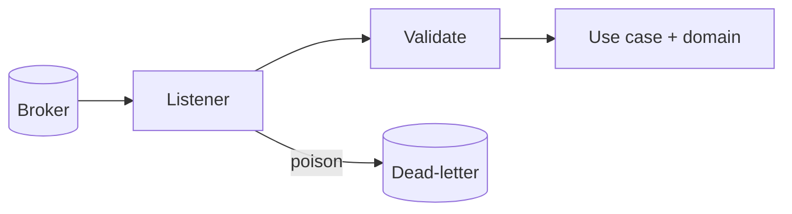

Some work arrives without a request waiting for an answer. Accounts closes a customer's account, and some time later an `AccountClosed` message reaches Subscriptions. Nobody is waiting on a response. The message is delivered at least once, sometimes twice, sometimes out of order, and sometimes malformed.

(Payment outcomes also arrive without anyone waiting, but Payments delivers them by webhook, not through the broker. They have their own section on the [HTTP page](/patterns/inside-a-service/inbound-http-gateway/#the-payments-webhook). Everything below about duplicates and acknowledgement applies to both.)

The inbound messaging gateway is the listener. It receives a message, checks it, translates it into a call to the [domain](/patterns/inside-a-service/domain/), and decides whether to acknowledge, retry or set it aside.

## One responsibility

A listener knows how to read a message and what to do when it cannot:

- Parse and validate the payload against the schema the sender promised
- Call the use case that matches the message
- Acknowledge on success; retry on a temporary failure; send to a dead-letter topic when retrying cannot help
- Ignore a message it has already processed

It makes no business decision. "A closed account cancels its subscriptions, including ones in a grace period" is in the domain. The listener never decides which subscriptions are affected.

Duplicates deserve special attention. Delivery is at least once, so the same `AccountClosed` can arrive twice. Processing it twice must not fail or publish a second `SubscriptionCancelled`. Recording processed message ids is the listener's job, since the domain does not know messages exist.



## The design

The handler is a plain function from a message to a decision about acknowledgement. The broker client calls it. Keeping it separate from the client means the contract and the delivery edge cases can be tested without waiting on a consumer group.

```typescript
// src/subscription/messaging/account-closed-handler.ts

const accountClosedSchema = z.object({
  messageId: z.string(),
  userId: z.string(),
  occurredAt: z.coerce.date(),
});

export type Outcome = "ack" | "retry" | "dead-letter";

export async function handleAccountClosed(raw: unknown): Promise<Outcome> {
  const parsed = accountClosedSchema.safeParse(raw);
  if (!parsed.success) return "dead-letter";

  const message = parsed.data;
  if (await alreadyProcessed(message.messageId)) return "ack";

  return (await cancelForClosedAccount(message.userId, message.occurredAt)).match(
    async () => { await markProcessed(message.messageId); return "ack" as const; },
    async (error) => error.code === SubscriptionErrors.UnableToSave.code ? "retry" : "dead-letter",
  );
}
```

The broker client wires handler to topic, and applies the outcome:

```typescript
// src/plumbing/subscribe.ts

consumer.run({
  eachMessage: async ({ topic, message }) => {
    const outcome = await handleAccountClosed(JSON.parse(message.value.toString()));
    if (outcome === "retry") throw new Error("retry");      // client redelivers
    if (outcome === "dead-letter") await producer.send({ topic: `${topic}.dlq`, messages: [message] });
  },
});
```

`alreadyProcessed` and `markProcessed` use the `processed_message` table from the [persistence](/patterns/inside-a-service/persistence/) page, so the handler's duplicate check is real database behaviour, not something to fake.

## Testing

Three tests, three questions.

**Message contract test:** Does the sender promise to send what we expect? The test states the payload Subscriptions expects, and the mock provides it to the handler. This is consumer-driven: Subscriptions defines the shape, and Accounts verifies that it sends it.

**Handler tests:** What does the listener do when delivery is imperfect? Tests with a real database cover duplicates, malformed payloads, and use-case failures. The use case is mocked (or spied on) to isolate the handler's concerns: parsing, validation, idempotency, error routing.

**Listener test:** Does a message on a real broker reach the handler, and is the outcome honoured (ack, retry, dead-letter)? One test with a real broker in a container proves the integration. It reuses the handler's logic but exercises the broker client, acknowledgement and retry mechanics.

```text
// Application architecture concept:
//   Broker -> Listener -> Use case
//
// Test boundary implementation:
//   contract message -> handleAccountClosed -> mock(use case)        [what message shape]
//   duplicate/malformed input -> handleAccountClosed -> db           [how handler decides]
//   producer -> RedpandaContainer -> consumer -> handleAccountClosed [broker integration]
```

```typescript
// test/non-dom/account-closed.consumer.test.ts

const provider = new PactV4({
  dir: resolve(process.cwd(), "pacts"),
  consumer: "subscriptions",
  provider: "accounts",
  spec: SpecificationVersion.SPECIFICATION_VERSION_V4,
});

it("reads an AccountClosed message", async () => {
  await provider
    .addAsynchronousInteraction()
    .given("a customer closed their account")
    .expectsToReceive("an AccountClosed message")
    .withJSONContent({
      messageId: like("msg-1"),
      userId: like("usr-1"),
      occurredAt: like("2026-11-01T10:00:00.000Z"),
    })
    .executeTest(async (message) => {
      const useCase = spyOn(cancelForClosedAccountModule, "cancelForClosedAccount")
        .mockReturnValueOnce(okAsync([aSubscription({ status: "cancelled" })]));

      const outcome = await handleAccountClosed(message.contents);

      expect(outcome).toBe("ack");
      expect(useCase).toHaveBeenCalledWith("usr-1", new Date("2026-11-01T10:00:00.000Z"));
    });
});
```

```typescript
// test/non-dom/account-closed-handler.test.ts

describe("messaging: account closed handler", () => {
  beforeEach(() => resetDb());

  const message = { messageId: "msg-1", userId: "usr-1", occurredAt: "2026-11-01T10:00:00Z" };

  it("ignores a message it has already processed", async () => {
    const useCase = spyOn(cancelForClosedAccountModule, "cancelForClosedAccount")
      .mockReturnValue(okAsync([aSubscription({ status: "cancelled" })]));

    await handleAccountClosed(message);
    const second = await handleAccountClosed(message);

    expect(second).toBe("ack");
    expect(useCase).toHaveBeenCalledTimes(1);
  });

  it("sends a malformed message to the dead-letter topic without calling the use case", async () => {
    const useCase = spyOn(cancelForClosedAccountModule, "cancelForClosedAccount");
    expect(await handleAccountClosed({ userId: 42 })).toBe("dead-letter");
    expect(useCase).not.toHaveBeenCalled();
  });

  it("retries when the subscriptions cannot be saved", async () => {
    spyOn(cancelForClosedAccountModule, "cancelForClosedAccount")
      .mockReturnValueOnce(errAsync(SubscriptionErrors.UnableToSave));
    expect(await handleAccountClosed(message)).toBe("retry");
  });

  it("acknowledges a user who has no subscriptions", async () => {
    spyOn(cancelForClosedAccountModule, "cancelForClosedAccount")
      .mockReturnValueOnce(okAsync([]));
    expect(await handleAccountClosed(message)).toBe("ack");
  });
});
```

```typescript
// test/non-dom/account-closed-listener.test.ts

describe("messaging: account closed listener (real broker)", () => {
  it("cancels the user's subscriptions when the message arrives on the topic", async () => {
    await save(aPlan({ id: "pln-1" }));
    await save(aSubscription({ id: "sub-1", userId: "usr-1", planId: "pln-1", status: "active" }));
    await startListeners();                                   // real consumer, real Redpanda

    await producer.send({
      topic: "accounts.account-closed",
      messages: [{ key: "usr-1", value: JSON.stringify(validAccountClosed("usr-1")) }],
    });

    await eventually(async () =>
      expect((await findById("sub-1"))._unsafeUnwrap().status).toBe("cancelled"));
  });

  it("moves a malformed message to the dead-letter topic", async () => {
    await startListeners();

    await producer.send({ topic: "accounts.account-closed", messages: [{ value: "{not json" }] });

    expect(await nextMessageOn("accounts.account-closed.dlq")).toBeDefined();
  });
});
```

The broker container is started once for the run, like the database. Topics are created per test run and message ids are unique, so tests do not need to wipe the broker between runs. Keep these listener tests to a handful. The handler tests above carry the cases.

### What this test cannot catch

**Whether Accounts really sends this payload:** The contract file is the evidence, and Accounts verifies it in their own tests (Part 3). The contract test here only proves Subscriptions can read what it promises to expect.

**Which subscriptions a closed account affects:** that a past-due subscription is cancelled too, or that an already cancelled one is left alone, are domain rules and belong in the [domain tests](/patterns/inside-a-service/domain/). Broker delivery order is a Redpanda concern, not a handler concern.

### Tools used

- [Testcontainers][tc] — Redpanda (Kafka-compatible) and PostgreSQL
- [Pact][pact] — message contracts
- [Bun test][bun_test] — test runner
- [Zod][zod] — message schema validation
- [KafkaJS][kafkajs] — broker client

[tc]: https://testcontainers.com
[pact]: https://docs.pact.io
[bun_test]: https://bun.sh/docs/cli/test
[zod]: https://zod.dev
[kafkajs]: https://kafka.js.org
