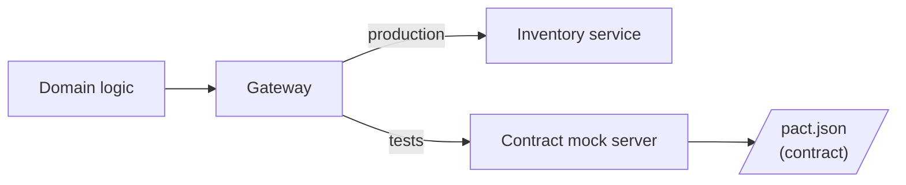

Subscriptions does not work alone. When a renewal is due it asks Payments to charge the customer, and before it starts a subscription for a physical product it asks Inventory to reserve stock. This page walks through Inventory, then adds Payments. Inventory has its own team, its own releases and its own data format. It changes in ways Subscriptions does not control.

The outbound gateway is where that impact lands. It speaks Inventory's language so the [domain](/patterns/inside-a-service/domain/) does not have to.

## One responsibility

A gateway makes the call and translates the response into something the domain understands. Everything outside the gateway uses the domain's words: `Reserved`, `OutOfStock`, `Unavailable`. Inventory's field names and status codes are known only here.

Without that, an Inventory change ripples through the codebase. A renamed field means changes in the domain, the routes and the tests.

The gateway also decides what a failure means to the caller. A `409 out of stock` is a normal business outcome, so it becomes a domain result. A `503` or a timeout means "unknown", so it becomes an error the domain can treat differently. Collapsing both into an exception would hide that difference.

## What changes and what stays the same

When Inventory changes its API, update the gateway. The domain does not change. When the domain remodels a concept, update the mapping in the gateway. Inventory does not change.

This also lets the two teams work independently. Subscriptions defines what it needs. Inventory defines what it provides. The gateway test records that need as a file Inventory can check (see Part 3).



## The design

Two parts: make the right call, and map the response. A separate type for Inventory's response keeps its shape out of the rest of the code.

```typescript
// src/gateway/inventory-remote-gateway.ts

const reservationResponseSchema = z.object({
  reservationId: z.string(),
  sku: z.string(),
  quantity: z.number(),
});

export type ReservationResult =
  | { type: "reserved"; reservationId: string }
  | { type: "out-of-stock" };

async function reserve(
  item: { sku: string; quantity: number },
  client = inventoryClient,
): Promise<Result<ReservationResult, GatewayError>> {
  const response = await client.post("reservations", { json: item, throwHttpErrors: false });

  if (response.status === 409) return ok({ type: "out-of-stock" });
  if (!response.ok) return err({ code: "inv-1", message: "inventory unavailable" });

  const body = reservationResponseSchema.parse(await response.json());
  return ok({ type: "reserved", reservationId: body.reservationId });
}
```

A static version returns fixed data. It serves local development and the [closed-box test](/patterns/inside-a-service/closed-box-test/).

```typescript
// src/gateway/inventory-static-gateway.ts

async function reserve(item: { sku: string; quantity: number }) {
  if (item.sku === "out-of-stock-sku") return ok({ type: "out-of-stock" } as const);
  return ok({ type: "reserved", reservationId: `res-${item.sku}` } as const);
}
```

One function chooses between them by configuration:

```typescript
// src/gateway/inventory-gateway.ts

export const reserve = remoteOrStatic(remoteReserve, staticReserve);
```

## Testing

Two things are tested: **what we send** and **what we do with the response**.

**Consumer contract test:** The test states what the gateway expects Inventory to do. A mock server is built from that statement, and the gateway is tested against it. This is consumer-driven contract testing: Subscriptions defines what it needs, and the result is a file (the pact) that the Inventory team can replay against their service. No shared test environment needed.

```text
// Application architecture concept:
//   Gateway --> Client --> Server
//
// Test boundary implementation:
//   inventoryGateway --> inventoryClient --> pactServerStub
```

The test covers success and failure paths. `out-of-stock` (409) and `unavailable` (503) are tested separately because the domain treats them differently: out-of-stock is a normal business outcome; unavailable is an error.

```typescript
// test/non-dom/inventory.consumer.test.ts

const provider = new PactV4({
  dir: resolve(process.cwd(), "pacts"),
  consumer: "subscriptions",
  provider: "inventory",
  spec: SpecificationVersion.SPECIFICATION_VERSION_V4,
});

it("reserves stock for a product", async () => {
  await provider
    .addInteraction()
    .given("sku coffee-250g has stock")
    .uponReceiving("a reservation request")
    .withRequest("POST", "/reservations", (b) =>
      b.jsonBody({ sku: "coffee-250g", quantity: 1 }))
    .willRespondWith(201, (b) =>
      b.jsonBody({ reservationId: like("res-1"), sku: "coffee-250g", quantity: 1 }))
    .executeTest(async (mock) => {
      const client = ky.create({ prefixUrl: mock.url });

      const result = await reserve({ sku: "coffee-250g", quantity: 1 }, client);

      expect(result._unsafeUnwrap()).toEqual({ type: "reserved", reservationId: "res-1" });
    });
});

it("reports out-of-stock as a result, not an error", async () => {
  await provider
    .addInteraction()
    .given("sku coffee-250g has no stock")
    .uponReceiving("a reservation request for an unavailable product")
    .withRequest("POST", "/reservations", (b) =>
      b.jsonBody({ sku: "coffee-250g", quantity: 1 }))
    .willRespondWith(409)
    .executeTest(async (mock) => {
      const client = ky.create({ prefixUrl: mock.url });
      const result = await reserve({ sku: "coffee-250g", quantity: 1 }, client);
      expect(result._unsafeUnwrap()).toEqual({ type: "out-of-stock" });
    });
});

it("returns an error when inventory is unavailable", async () => {
  await provider
    .addInteraction()
    .given("inventory is degraded")
    .uponReceiving("a reservation request during an outage")
    .withRequest("POST", "/reservations", (b) =>
      b.jsonBody({ sku: "coffee-250g", quantity: 1 }))
    .willRespondWith(503)
    .executeTest(async (mock) => {
      const client = ky.create({ prefixUrl: mock.url });
      const result = await reserve({ sku: "coffee-250g", quantity: 1 }, client);
      expect(result._unsafeUnwrapErr()).toMatchObject({ code: "inv-1" });
    });
});
```

A timeout is not covered by a contract mock. Add one test against a plain stub server that delays its response.

## The Payments gateway

The second outbound HTTP gateway asks Payments to charge for a renewal. It follows the same shape, with two differences worth stating.

**The answer is not the outcome.** `POST /charges` answers `201` with `pending`. That means "accepted", not "paid". The gateway returns `accepted` and nothing more; success or failure arrives later on the [webhook](/patterns/inside-a-service/inbound-http-gateway/#the-payments-webhook). A gateway that returned `paid` would be lying about what it knows.

**Retrying must be safe.** A timeout leaves Subscriptions not knowing whether the charge was created. The request carries an idempotency key derived from the subscription and the billing period, so asking again returns the same charge.

```typescript
// src/gateway/payments-remote-gateway.ts

export type ChargeRequest = { subscriptionId: string; idempotencyKey: string; amount: number; currency: string };
export type ChargeResult = { type: "accepted"; chargeId: string } | { type: "rejected"; reason: string };

async function requestCharge(
  charge: ChargeRequest,
  client = paymentsClient,
): Promise<Result<ChargeResult, GatewayError>> {
  const response = await client.post("charges", { json: charge, throwHttpErrors: false });

  if (response.status === 400) return ok({ type: "rejected", reason: "invalid-request" });
  if (!response.ok) return err({ code: "pay-1", message: "payments unavailable" });

  const body = chargeResponseSchema.parse(await response.json());
  return ok({ type: "accepted", chargeId: body.chargeId });
}
```

A `400` is a normal result because retrying the same request cannot help. Anything else that is not a success is an error the caller may retry.

```typescript
// test/non-dom/payments.consumer.test.ts

it("requests a charge and receives a pending charge id", async () => {
  await new PactV4({
    dir: resolve(process.cwd(), "pacts"),
    consumer: "subscriptions",
    provider: "payments",
    spec: SpecificationVersion.SPECIFICATION_VERSION_V4,
  })
    .addInteraction()
    .given("a subscription can be charged")
    .uponReceiving("a charge request")
    .withRequest("POST", "/charges", (b) =>
      b.jsonBody({
        subscriptionId: like("sub-1"),
        idempotencyKey: like("sub-1:2026-11"),
        amount: like(999),
        currency: like("usd"),
      }))
    .willRespondWith(201, (b) =>
      b.jsonBody({ chargeId: like("ch-1"), status: "pending" }))
    .executeTest(async (mock) => {
      const client = ky.create({ prefixUrl: mock.url });

      const result = await requestCharge(aChargeRequest(), client);

      expect(result._unsafeUnwrap()).toEqual({ type: "accepted", chargeId: "ch-1" });
    });
});
```

The static version used by the closed-box test records the requests it receives, so a test can assert that a renewal asked for a charge exactly once.

### What this test cannot catch

**Whether Inventory or Payments really reply this way.** The contract test proves we *can read* what we promised; the pact file is the evidence. When Inventory replays the contract against their service (Part 3), they verify they *do send* it. This is the consumer-producer handoff: the consumer (Subscriptions) proves they understand the contract, and the provider (Inventory) proves they uphold it. Together, they prove the integration works.

**Timeouts.** A contract mock cannot delay its response. A separate test with a plain stub server covers timeout handling.

### Tools used

- [Pact][pact] — consumer-driven contract testing
- [Bun test][bun_test] — test runner
- [Zod][zod] — response schema validation
- [ky][ky] — HTTP client

[pact]: https://docs.pact.io
[bun_test]: https://bun.sh/docs/cli/test
[zod]: https://zod.dev
[ky]: https://github.com/sindresorhus/ky
