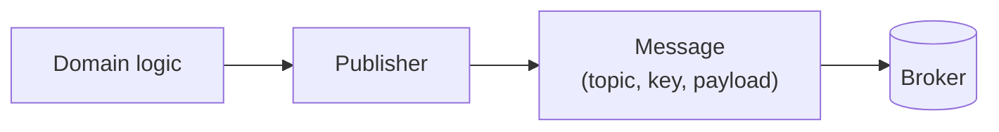

When a renewal succeeds or a subscription is cancelled, Subscriptions publishes `SubscriptionRenewed` or `SubscriptionCancelled` for whoever is interested, such as Accounts, a notification service or analytics. It does not wait for anyone to read them.

(Charging the customer is not a message. Subscriptions asks Payments with a synchronous `POST /charges`; see the [outbound HTTP gateway](/patterns/inside-a-service/outbound-http-gateway/).)

The outbound messaging gateway is the publisher. It translates a domain event into the message format the broker and its readers expect.

## One responsibility

A publisher turns a domain event into a message: payload shape, topic, partition key, headers. It sends it and reports whether that worked. It does not decide whether an event happens.

The message format is a promise to other teams. Subscriptions does not control who reads `SubscriptionRenewed` or what they do with it. Changing a field name here can break a service nobody on this team has heard of. This is why the publisher is its own boundary with its own tests: the shape of what leaves is a public interface.

Two details are easy to miss:

- The key matters. Using the subscription id keeps events for one subscription in order.
- The domain event is not the message. Internal fields stay internal, and the message is versioned independently.



## The design

The publisher turns the domain event into a message and hands it to the broker client. The client is the only code that knows the library.

```typescript
// src/subscription/messaging/subscription-renewed-publisher.ts

export type SubscriptionRenewedMessage = {
  messageId: string;
  subscriptionId: string;
  userId: string;
  planId: string;
  renewedUntil: string;
};

export function toMessage(s: Subscription): SubscriptionRenewedMessage {
  return {
    messageId: id("msg"),
    subscriptionId: s.id,
    userId: s.userId,
    planId: s.planId,
    renewedUntil: s.renewOn.toISOString(),
  };
}

export function publishSubscriptionRenewed(s: Subscription, producer = defaultProducer) {
  return ResultAsync.fromPromise(
    producer.send({
      topic: "subscriptions.subscription-renewed",
      messages: [{ key: s.id, value: JSON.stringify(toMessage(s)) }],
    }),
    toBusError,
  );
}
```

## Testing

Two tests, two questions.

**Is the payload what we promise?** A contract check. Here Subscriptions is the provider, so the check is a provider-side verification of expectations the consumers wrote. This test needs no container—it checks the shape of the value returned by `toMessage()`.

**Does the publisher really work on a real broker?** A test with a real broker in a container, reading back what was sent. The contract test alone only proves the payload shape; the real broker test proves the publisher succeeds, uses the right topic and key, and the message is readable by consumers. Without it, we might verify the shape but ship a publisher that cannot actually connect, send, or serialize correctly.

```text
// Application architecture concept:
//   Domain -> Publisher -> Broker
//
// Test boundary implementation:
//   toMessage -> contract verification
//   publisher -> RedpandaContainer <- test consumer
```

```typescript
// test/non-dom/subscription-renewed-publisher.test.ts

describe("messaging: subscription renewed publisher (real broker)", () => {
  it("publishes to the renewal topic keyed by subscription id", async () => {
    const received = collectFrom("subscriptions.subscription-renewed");   // test consumer

    await publishSubscriptionRenewed(aSubscription({ id: "sub-1" }));

    const [message] = await received.next(1);
    expect(message.key).toBe("sub-1");
    expect(JSON.parse(message.value)).toMatchObject({ subscriptionId: "sub-1" });
  });

  it("keeps events for one subscription in order", async () => {
    const received = collectFrom("subscriptions.subscription-renewed");

    await publishSubscriptionRenewed(aSubscription({ id: "sub-1", renewOn: new Date("2026-12-01") }));
    await publishSubscriptionRenewed(aSubscription({ id: "sub-1", renewOn: new Date("2027-01-01") }));

    const messages = await received.next(2);
    expect(messages.map((m) => JSON.parse(m.value).renewedUntil)).toEqual([
      "2026-12-01T00:00:00.000Z",
      "2027-01-01T00:00:00.000Z",
    ]);
  });

  it("returns an error when the broker is unreachable", async () => {
    const result = await publishSubscriptionRenewed(aSubscription(), producerFor("localhost:1"));
    expect(result.isErr()).toBeTrue();
  });
});
```

The contract verification runs consumer-written expectations against the message the publisher produces. It needs no container, because it checks the shape of a value:

```typescript
// test/non-dom/subscription-renewed.provider.test.ts

it("meets the expectations of consumers", async () => {
  await new MessageProviderPact({
    provider: "subscriptions",
    pactUrls: [resolve("pacts/accounts-subscriptions.json")],
    messageProviders: {
      "a SubscriptionRenewed message": async () =>
        toMessage(aSubscription({ id: "sub-1", status: "active" })),
    },
  }).verify();
});
```

Before any consumer writes a contract, the team can pin the shape itself with a JSON schema check against `toMessage`, committed to the repository. It catches accidental changes to the message shape until Part 3 sets up the exchange of contracts with real consumers. This buys time early and prevents silent shape regressions.

### What this test cannot catch

**Whether any consumer can actually read what the broker holds:** A real broker proves our side publishes correctly. The contract proves the shape we promise. Only the consumer's own tests and the contract verification on their side prove they read it correctly and handle our message format. This is Part 3's handoff: the provider test here and the consumer test on the reader's side (for example Accounts) together verify the message contract.

### Tools used

- [Testcontainers][tc] — Redpanda (Kafka-compatible)
- [Pact][pact] — message provider verification
- [Bun test][bun_test] — test runner
- [KafkaJS][kafkajs] — broker client

[tc]: https://testcontainers.com
[pact]: https://docs.pact.io
[bun_test]: https://bun.sh/docs/cli/test
[kafkajs]: https://kafka.js.org
