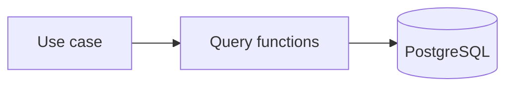

Databases behave in ways that are hard to imitate. Null handling, date round-trips, constraints, ordering and locking all differ from what a hand-written mock returns, and in-memory substitutes differ from the real engine in just the places that bite. A mock that returns what you tell it to never shows a wrong column type or a missing index.

The persistence boundary is the code that reads and writes storage. It translates the domain's `Subscription` into rows and back. It is the only place that knows table and column names.

## One responsibility

Persistence code stores and retrieves. It does not decide whether a subscription may be cancelled; the [domain](/patterns/inside-a-service/domain/) does. It answers "did the save work?" and "what does the database hold?".

Tested against the production database engine, it catches what mocks and lookalikes cannot: a constraint you forgot, a `timestamptz` that shifts by a time zone, a query that returns rows in a surprising order.

For Subscriptions, the less obvious queries matter most. The nightly job asks "which `past_due` subscriptions have a grace period that ended before now?". A mistake there leaves customers in grace forever, and no domain test would notice.



## The design

One function per question the domain needs answered, each returning a typed result. The schema comes from the same migration files production uses. Nothing is written separately for tests.

For Subscriptions, the main queries are:
- `findById(id)` — Load a subscription for updates
- `findPlan(planId)` — Load a plan for domain rules
- `save(subscription)` — Insert or update after a state transition
- `findPastDueWithGraceEndedBefore(date)` — Subscriptions to cancel (used by the nightly job)
- `alreadyProcessed(messageId)` and `markProcessed(messageId)` — Idempotency guards for message listeners

Each is tested against the production database engine in a container.

```sql
-- db/migrations/V1__subscription.sql

create table plan (
  id         text primary key,
  interval   text not null,
  grace_days integer not null
);

create table subscription (
  id            text primary key,
  user_id       text not null,
  plan_id       text not null references plan (id),
  start_date    timestamptz not null,
  renew_on      timestamptz not null,
  grace_ends_on timestamptz,
  status        text not null check (status in ('active','past_due','cancelled','ended'))
);

create table processed_message (
  message_id text primary key
);
```

```typescript
// src/subscription/subscription-db.ts

function findById(id: string): ResultAsync<Subscription, SubscriptionError> {
  return ResultAsync.fromPromise(
    sql`select * from subscription where id = ${id}`,
    toDbError,
  ).andThen(([row]) => (row ? ok(toSubscription(row)) : err(SubscriptionErrors.NotFound)));
}

function findPastDueWithGraceEndedBefore(at: Date): ResultAsync<Array<Subscription>, DbError> {
  return ResultAsync.fromPromise(
    sql`select * from subscription where status = 'past_due' and grace_ends_on <= ${at}`,
    toDbError,
  ).map((rows) => rows.map(toSubscription));
}

function save(s: Subscription): ResultAsync<Subscription, DbError> {
  return ResultAsync.fromPromise(
    sql`insert into subscription (id, user_id, plan_id, start_date, renew_on, grace_ends_on, status)
        values (${s.id}, ${s.userId}, ${s.planId}, ${s.startDate}, ${s.renewOn}, ${s.graceEndsOn ?? null}, ${s.status})
        on conflict (id) do update set
          renew_on = excluded.renew_on,
          grace_ends_on = excluded.grace_ends_on,
          status = excluded.status`,
    toDbError,
  ).map(() => s);
}
```

## Testing

A single PostgreSQL container starts once for the whole test run. The migrations are applied to it. Between tests the tables are emptied, which takes milliseconds, so every test starts from a known state without paying container start-up again.

```text
// Application architecture concept:
//   QueryFn -> StorageClient -> Storage System
//
// Test boundary implementation:
//   findPastDueWithGraceEndedBefore -> sql -> PostgresContainer
```

The container setup is shared by the persistence, use case, messaging and closed-box tests:

```typescript
// test/support/containers.ts  (loaded once through bunfig.toml: preload)

let postgres: StartedPostgreSqlContainer;

export async function startPostgres() {
  postgres ??= await new PostgreSqlContainer("postgres:17")
    .withReuse()                                 // optional: keep it between local runs
    .start();
  process.env.DATABASE_URL = postgres.getConnectionUri();
  await migrate(process.env.DATABASE_URL);       // the production migration files
}

export async function resetDb() {
  await sql`truncate subscription, plan, processed_message cascade`;
}
```

```typescript
// test/non-dom/subscription/subscription-db.test.ts

describe("db: subscription", () => {
  beforeEach(() => resetDb());

  it("keeps every field through a round trip", async () => {
    await save(aPlan({ id: "pln-1" }));
    const original = aSubscription({
      planId: "pln-1",
      status: "past_due",
      graceEndsOn: new Date("2026-11-04T10:15:30.123Z"),
    });
    await save(original);

    expect((await findById(original.id))._unsafeUnwrap()).toEqual(original);
  });

  it("returns not found for an unknown id", async () => {
    expect((await findById("sub-nope"))._unsafeUnwrapErr()).toEqual(SubscriptionErrors.NotFound);
  });

  it("finds only past-due subscriptions whose grace has ended", async () => {
    await save(aPlan({ id: "pln-1" }));
    await save(aSubscription({ id: "ended",   planId: "pln-1", status: "past_due", graceEndsOn: new Date("2026-11-03") }));
    await save(aSubscription({ id: "ongoing", planId: "pln-1", status: "past_due", graceEndsOn: new Date("2026-11-05") }));
    await save(aSubscription({ id: "active",  planId: "pln-1", status: "active" }));

    const found = await findPastDueWithGraceEndedBefore(new Date("2026-11-04"));

    expect(found._unsafeUnwrap().map((s) => s.id)).toEqual(["ended"]);
  });

  it("rejects a subscription whose plan does not exist", async () => {
    const result = await save(aSubscription({ planId: "pln-nope" }));
    expect(result.isErr()).toBeTrue();
  });
});
```

The last test is why a real engine matters: the foreign key is enforced by the database, and no mock would have raised it.

### Cost and how it is managed

Starting a container costs seconds, once. Keep it that way: one container per run, tables truncated between tests, no container per test file. Locally, Docker's `--reuse` flag makes repeated runs near-instant (the container persists between runs but tables are fresh). When the suite grows, run test files in parallel against separate schemas in the same container, or use dedicated containers per file (the cost is paid once at start-up).

### Tools used

- [Testcontainers][tc] — PostgreSQL in Docker
- [Bun SQL][bun_sql] — database client
- [Bun test][bun_test] — test runner
- [neverthrow][neverthrow] — typed result values

[tc]: https://testcontainers.com
[bun_sql]: https://bun.sh/docs/api/sql
[bun_test]: https://bun.sh/docs/cli/test
[neverthrow]: https://github.com/supermacro/neverthrow
