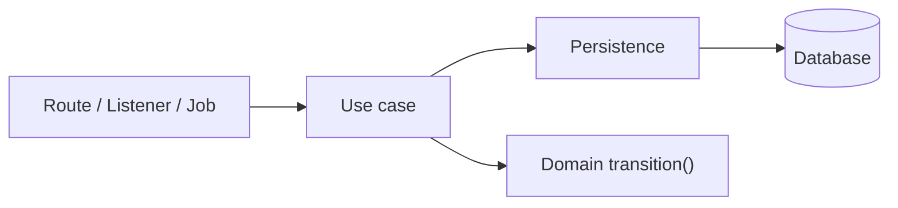

The [domain](/patterns/inside-a-service/domain/) decides. It cannot fetch the subscription it is deciding about or store the result. Something has to do that, and the same something has to be callable from an HTTP route, a message listener and a nightly job.

A use case is that something. It is a short function with one fixed shape: **load, decide, store** (and publish, when the outcome needs announcing).

## One responsibility

A use case coordinates. It asks [persistence](/patterns/inside-a-service/persistence/) for the subscription and plan, hands them to the domain, saves what the domain returns, and passes errors up unchanged. It contains no rules. If a use case grows an `if` about business, the `if` belongs in the domain.

Keeping it thin means a handful of tests are enough. The rules are tested in the domain, the queries in persistence, and the use case tests need only prove the three are connected and that a failure at either end is reported.



## The design

```typescript
// src/subscription/record-payment-failure.ts

export function recordPaymentFailure(
  id: string,
  at: Date,
): ResultAsync<Subscription, SubscriptionError> {
  return findById(id).andThen((subscription) =>
    findPlan(subscription.planId)
      .andThen((plan) => transition(subscription, plan, { type: "payment-failed", at }))
      .andThen(save),
  );
}
```

The other entry points use the same shape. `recordPaymentSuccess` (called by the Payments webhook) applies `payment-succeeded`. `cancelForClosedAccount` (called by the `AccountClosed` listener) loads every non-cancelled subscription of a user with `findActiveByUser`, applies `cancel` to each, and saves them in one transaction. Renewal asks Payments for a charge through the [outbound gateway](/patterns/inside-a-service/outbound-http-gateway/) and records nothing until the outcome arrives.

## Testing

The test uses a real database in a container, the same one the [persistence tests](/patterns/inside-a-service/persistence/) use. The pattern is **happy path + one failure per I/O boundary**:

- Happy path: Load succeeds, domain decides, save succeeds
- Load failure: `findById` returns `NotFound`; use case propagates it
- Domain failure: An invalid transition is rejected; nothing is saved
- Save failure: A spy replaces `save` to force a failure that a healthy database does not produce on demand

```text
// Application architecture concept:
//   UseCase -> Persistence -> Database
//   UseCase -> Domain
//
// Test boundary implementation:
//   recordPaymentFailure -> findById -> PostgresContainer      // load path
//   recordPaymentFailure -> transition -> Domain               // domain path
//   recordPaymentFailure -> save -> PostgresContainer          // happy path
//   recordPaymentFailure -> save(spy) -> failure               // failure path
```

```typescript
// test/non-dom/subscription/record-payment-failure.test.ts

describe("use case: record payment failure", () => {
  beforeEach(() => resetDb());                  // truncate tables, same container

  it("stores the subscription as past due", async () => {
    await save(aPlan({ id: "pln-1", graceDays: 3 }));
    await save(aSubscription({ id: "sub-1", planId: "pln-1", status: "active" }));

    const result = await recordPaymentFailure("sub-1", new Date("2026-11-01"));

    expect(result.isOk()).toBeTrue();
    expect((await findById("sub-1"))._unsafeUnwrap()).toMatchObject({
      status: "past_due",
      graceEndsOn: new Date("2026-11-04"),
    });
  });

  it("returns not found for an unknown subscription", async () => {
    const result = await recordPaymentFailure("sub-nope", new Date());
    expect(result._unsafeUnwrapErr()).toEqual(SubscriptionErrors.NotFound);
  });

  it("returns the domain's error for an invalid transition and stores nothing", async () => {
    await save(aPlan({ id: "pln-1" }));
    await save(aSubscription({ id: "sub-1", planId: "pln-1", status: "cancelled" }));

    const result = await recordPaymentFailure("sub-1", new Date());

    expect(result._unsafeUnwrapErr()).toEqual(SubscriptionErrors.InvalidTransition);
    expect((await findById("sub-1"))._unsafeUnwrap().status).toBe("cancelled");
  });

  it("returns an error when saving fails", async () => {
    await save(aPlan({ id: "pln-1" }));
    await save(aSubscription({ id: "sub-1", planId: "pln-1", status: "active" }));
    spyOn(sdb, "save").mockReturnValueOnce(errAsync({ code: "db-1", details: "oops" }));

    const result = await recordPaymentFailure("sub-1", new Date());

    expect(result._unsafeUnwrapErr()).toMatchObject({ code: "db-1", details: "oops" });
  });
});
```

### What this test cannot catch

Rule details (the [domain tests](/patterns/inside-a-service/domain/) cover them) and how requests or messages reach the use case (the [inbound gateway tests](/patterns/inside-a-service/inbound-http-gateway/) and [messaging](/patterns/inside-a-service/inbound-messaging/) tests do).

### Tools used

- [Bun test][bun_test] — test runner
- [neverthrow][neverthrow] — typed result values
- [Testcontainers][tc] — Postgres, shared with the persistence tests

[bun_test]: https://bun.sh/docs/cli/test
[neverthrow]: https://github.com/supermacro/neverthrow
[tc]: https://testcontainers.com
