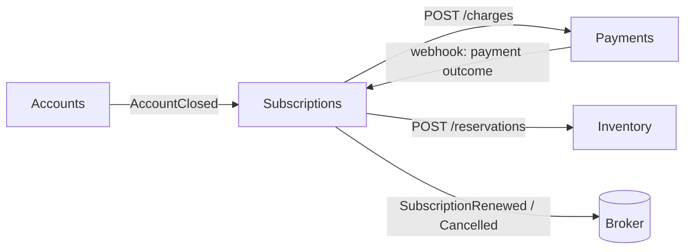

Every pattern uses one product: a coffee subscription split across four teams.

| Service | Owns |
|---|---|
| **Subscriptions** | plans, subscription lifecycle, billing cycle, renewals, cancellation |
| Inventory | product stock and reservations |
| Payments | charging, refunds, payment methods |
| Accounts | users, profiles, account closure |

Start with [the journey through one service](/journeys/build-one-service-testably/).
